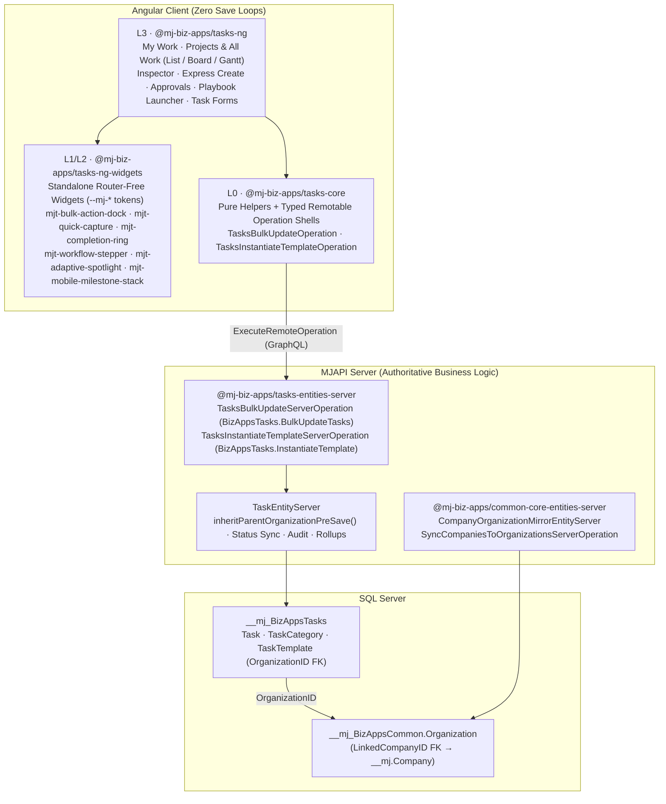

# Tasks UX Redesign, Organization Scoping & Server-Side Bulk Operations Guide

> **Shareable Offline Version:** Open [`TASKS_UX_ORGANIZATION_AND_BULK_OPS_GUIDE.html`](./TASKS_UX_ORGANIZATION_AND_BULK_OPS_GUIDE.html) in any browser for the full interactive, self-contained HTML edition with 19 embedded base64 2× HiDPI screenshots, native `<dialog closedby="any">` zoomable lightbox, and Light/Dark toggle.

This guide covers the **Golden Hybrid WCAG 2.1 AA Tasks UX** architecture (`My Work` default tab, `All Work` Tree List / Board / Gantt Timeline, **UserInfoEngine Saved Filter Views**, shared **Multi-View Bulk Action Dock**, FAB-suppressed drawers, and clean Approvals split-pane), **canonical Organization / Company scoping** across multi-entity and client workflows, and **server-side Remotable Operations + Actions** (`BizAppsTasks.BulkUpdateTasks`, `BizAppsTasks.InstantiateTemplate`, `BizAppsTasks.RunRecurringPlaybooks`, `Run Recurring Playbooks`).

---

## 1. Architecture Overview (3-Layer + Server-First)

All business logic, multi-row mutations, and playbook orchestration execute authoritatively on the server through MemberJunction `BaseEntity` subclasses and `BaseRemotableOperation` RPCs. The Angular UI is a thin, responsive presentation layer built exclusively with MJ Generic components and `--mj-*` semantic design tokens.



---

## 2. Canonical Organization Scoping (Multi-Tenant Companies + External Orgs)

Rather than duplicating `CompanyID` across every table, Tasks scopes **aggregate roots only** to canonical `MJ_BizApps_Common: Organizations` (`V202611201600__v1.15.x__Organization_Scoping.sql`):

| Table | Column | Nullable | Indexed | Rationale |
| :--- | :--- | :--- | :--- | :--- |
| `Task` | `OrganizationID` | Yes | `IDX_AUTO_MJ_FKEY_Task_OrganizationID` | Primary work item scope (internal Company or external Client) |
| `TaskCategory` | `OrganizationID` | Yes | `IDX_AUTO_MJ_FKEY_TaskCategory_OrganizationID` | Optional org-scoped project / close-period folders |
| `TaskTemplate` | `OrganizationID` | Yes | `IDX_AUTO_MJ_FKEY_TaskTemplate_OrganizationID` | Default organization scope for reusable playbooks |
| Child tables (`TaskAssignment`, `TaskComment`, `TaskDependency`, `TaskActivity`, `TaskCheckIn`, etc.) | *(none)* | — | — | Always inherit scope from their parent `Task` — zero denormalization drift |

### Internal Companies & External Organizations Unified
In `@mj-biz-apps/common-core-entities-server`, every `MJ: Companies` record is automatically mirrored into `MJ_BizApps_Common: Organizations` via `Organization.LinkedCompanyID`. Pickers and filters across Tasks sort mirrored internal Companies first with a clear `★ Name (Company)` visual badge alongside external Organizations (clients, partners, vendors) where `LinkedCompanyID IS NULL`.

### Automatic Sub-Task Inheritance (`TaskEntityServer`)
When creating a new child sub-task (`IsSaved = false`) whose `ParentID` is set and whose `OrganizationID` is left `null`, `TaskEntityServer.inheritParentOrganizationPreSave()` automatically looks up the parent task's `OrganizationID` and inherits it on the server.
- Explicit `OrganizationID` values supplied on child creation are respected.
- Intentionally clearing `OrganizationID` on an already-saved task (`IsSaved = true`) is never overwritten.

---

## 3. Unified Filtering & Indicators Across List, Board & Gantt

Every view in **Projects & All Work** (`<bizapps-tasks-dashboard-page>`) shares one `<mj-filter-panel>` popover with six filters applied consistently across **Tree List**, **Board**, and **Gantt Timeline**:

- **Assignee**: `All assignees`, `Assigned to Me` (matches direct Person assignment or any of the user's MJ Roles), `Unassigned`, individual People, or MJ Roles.
- **Due Date**: `Overdue` (active tasks only — excludes Completed/Cancelled), `Due Today`, `Next 7 Days`, `Next 30 Days`, or `No Due Date`.
- **Organization / Company**: `All organizations`, `No organization`, mirrored Companies (`★ Name (Company)`), and external Organizations. Selecting an Organization filter also pre-fills `DefaultOrganizationID` in both the **New Task** Express Create drawer and the **From Template** Playbook Launcher.
- **Status**, **Priority**, and **Task Type**.

### View-Specific Enhancements
- **Tree List (`<bizapps-task-list>`)**: Displays Organization badges, rich Assignee chips (avatar initials + short name + `+N` overflow + MJ Role icon pill), WBS child rollup counts (`1/3`), tactile completion rings, `TaskTypeStatus` stage pills, polymorphic `mjRecordLink` business records, and Shift+click range selection.
- **Board (`<bizapps-task-kanban>`)**: 5 grouping modes persisted via `UserInfoEngine` (never `localStorage`): **Organization / Company**, **Macro Status**, **Workflow Stages (`TaskTypeStatus`)**, **Priority**, and **Assignee** — with solid semantic status badge contrast and non-redundant card footers.
- **Gantt Timeline (`<bizapps-task-gantt>`)**: Dedicated **`Assignee`** and **`Organization`** columns rendered beside the DHTMLX timeline (with XSS-safe HTML escaping and an expanded default `GridWidth` of `485px`), Finish-to-Start dependency arrows, zoom persistence, and 1-click **Critical Path** isolation. On phone viewports (`<= 640px`), automatically swaps to `<mjt-mobile-milestone-stack>`.

---

## 4. Server-Side Remotable Operations

### `BizAppsTasks.BulkUpdateTasks` (`TasksBulkUpdateOperation`)
Replaces client-side save loops with a single authoritative server RPC supporting up to **500 tasks per call**, deduplicating task IDs, validating UUIDs against SQL injection, firing all `TaskEntityServer` lifecycle/audit hooks, and reporting granular partial failures without aborting remaining tasks.

Supported patch dimensions:
- **Reassign (`AssigneeMode`: `'replace' | 'add' | 'clear'`)**: Works for both `MJ_BizApps_Common: People` and `MJ: Roles` with optional `AssigneeRoleID`. `'add'` is idempotent (never creates duplicate assignment rows).
- **Redate (`DueDateMode`: `'set' | 'shift' | 'clear'`)**: `'shift'` moves both `DueAt` and `StartedAt` in lockstep by `ShiftDays` (positive or negative integer).
- **Start Date (`StartDateMode`: `'set' | 'clear'`)**
- **Status & Priority**: Setting `Status = 'Completed'` automatically populates `PercentComplete = 100` and `CompletedAt`.
- **Organization (`OrganizationMode`: `'set' | 'clear'`)** & **Category (`CategoryMode`: `'set' | 'clear'`)**
- **Task Type (`TypeID`)**, **Workflow Stage (`TaskTypeStatusID`)**, and **Idempotent Tag Attachment (`AddTagID`)**

```typescript
import { TasksBulkUpdateOperation } from '@mj-biz-apps/tasks-core';

const result = await new TasksBulkUpdateOperation().Execute({
    TaskIDs: selectedIds,
    DueDateMode: 'shift',
    ShiftDays: 2,
    OrganizationMode: 'set',
    OrganizationID: usCompanyOrgId,
    AssigneeMode: 'replace',
    AssigneeEntityName: 'MJ_BizApps_Common: People',
    AssigneeRecordID: controllerPersonId,
});
```

### `BizAppsTasks.InstantiateTemplate` (`TasksInstantiateTemplateOperation`)
Instantiates a multi-step `TaskTemplate` server-side in a single RPC:
1. Topologically sorts `TaskTemplateItem` rows so parents are always created before children (even when stored out of order).
2. Calculates relative `DueAt` dates from `StartDate + DaysFromStart`.
3. Stamps `OrganizationID` (caller override → template default → `null`) and `CategoryID` onto every generated task.
4. Maps `TaskTemplateItemRole` slots to concrete People or MJ Roles via `RoleAssignments`.
5. Recreates `TaskTemplateItemDependency` edges as live `TaskDependency` rows.

```typescript
import { TasksInstantiateTemplateOperation } from '@mj-biz-apps/tasks-core';

const result = await new TasksInstantiateTemplateOperation().Execute({
    TemplateID: monthlyCloseTemplateId,
    StartDate: '2026-12-01',
    OrganizationID: usCompanyOrgId,
    RoleAssignments: [
        { RoleID: primaryRoleId, EntityName: 'MJ_BizApps_Common: People', RecordID: controllerPersonId },
    ],
});
```

---

## 5. Testing & Verification

```bash
# Unit tests across all Tasks packages
pnpm --filter @mj-biz-apps/tasks-core test
pnpm --filter @mj-biz-apps/tasks-entities-server test
pnpm --filter @mj-biz-apps/tasks-actions test
pnpm --filter @mj-biz-apps/tasks-server test
pnpm --filter @mj-biz-apps/tasks-ng-widgets test
pnpm --filter @mj-biz-apps/tasks-ng test
pnpm --filter @mj-biz-apps/tasks-integration-tests test

# Live GraphQL integration bundle (requires running MJAPI with GRAPHQL_PORT + MJ_API_KEY)
pnpm --filter @mj-biz-apps/tasks-integration-tests build
node test-harnesses/integration.mjs task-org-bulk-ops
```
