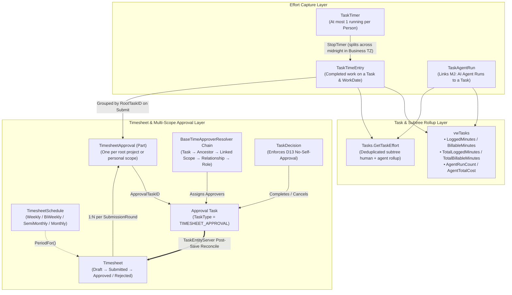
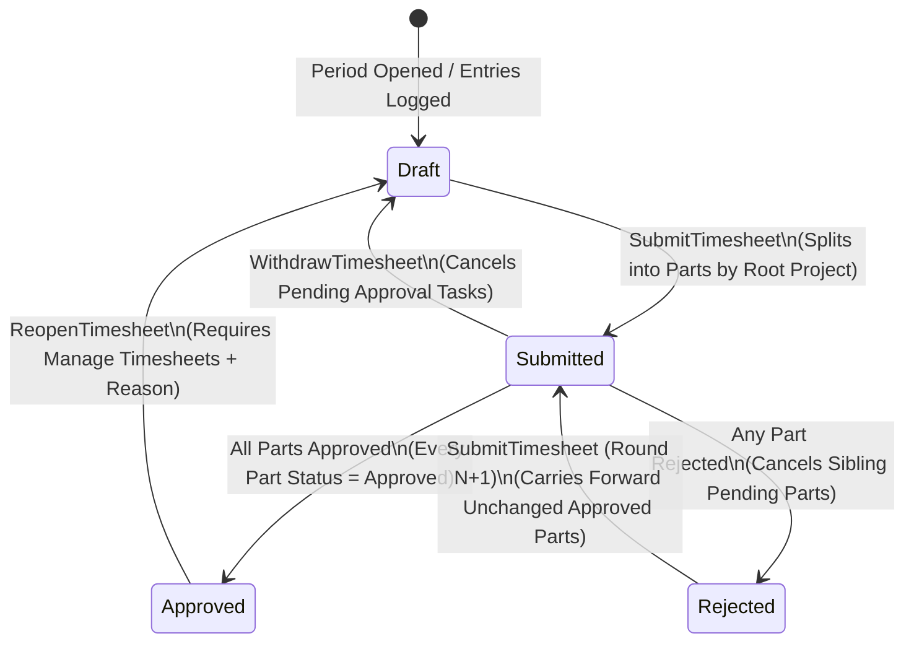
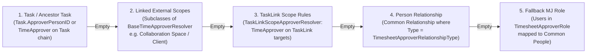

# BizApps Tasks — Time Tracking, AI Agent Effort & Timesheets Guide

This guide provides the end-to-end user, host administrator, and developer reference for **Time Tracking**, **Live Task Timers**, **AI Agent Effort Rollups**, and **Multi-Project Timesheet Approval Workflows** in `bizapps-tasks`.

---

## 1. Architectural Overview

Time tracking in BizApps Tasks captures both **human effort** (`TaskTimeEntry`, `TaskTimer`) and **autonomous AI agent effort** (`TaskAgentRun`) on the same task hierarchy, then rolls human time into period **Timesheets** (`Timesheet`, `TimesheetApproval`) routed through Tasks' native approval machinery (`Approval Request` / `TIMESHEET_APPROVAL` tasks and `TaskDecision` records).



---

## 2. User Guide

### 2.1 Starting, Switching, and Stopping a Timer

Each person can have at most **one running timer** (`TaskTimer`) at a time, enforced both by `TaskTimerServer` and by a filtered unique database index on `TaskTimer(PersonID)`.

1. **Start a Timer**: Click **Start Timer** on any task header, card, or in the **My Time** dashboard.
   - If you already have a timer running on another task, `TaskTimerServer.StartTimer()` automatically stops the previous timer and saves its `TaskTimeEntry` row(s) inside the same database transaction before starting the new timer.
2. **Header Timer Chip**: While a timer is running, the live `<mj-tasks-running-timer-chip>` displays elapsed `HH:MM:SS` in real time and provides quick **Stop**, **Open Task**, and **Discard** actions.
3. **Cross-Midnight Splitting (D5)**: When a timer runs across midnight in the organization's configured business time zone (`BusinessTimeZoneEngine`), `StopTimer` automatically splits the elapsed span into one `TaskTimeEntry` per business calendar day so daily and period boundaries remain exact.
4. **Short-Timer Discard**: Timers stopped under `DiscardIfUnderSeconds` (or explicitly discarded via **Discard**) delete the `TaskTimer` row without creating a noise `TaskTimeEntry`.

### 2.2 Logging and Editing Time Manually

You can log or edit time entries in two places:
- **Task Form — Time & Effort Panel (`<mj-tasks-time-and-effort-panel>`)**: Open any task to view its logged entries, start/stop a timer on that task, or log a manual entry with `WorkDate`, `Minutes` (or `HH:MM`), `IsBillable`, and `Description`.
- **My Time — Weekly Grid (`<mj-tasks-my-time-section>`)**: Enter hours directly into the 7-day task-by-day matrix. Each cell edit saves or updates the underlying `TaskTimeEntry` row (`Source = 'Manual'`).

> [!IMPORTANT]
> **Validation & Integrity Rules on Every Save (`TaskTimeEntryEntityServer`)**:
> - **R1 (Default Owner)**: If `PersonID` is omitted, it defaults to the signed-in user's linked `Person` record.
> - **R2 (Ownership & Authorization)**: You may only create, update, or delete your own time entries unless your role holds the `Manage Time Entries` authorization.
> - **R3 (Positive Duration & Rounding)**: `Minutes` must be between `1` and `1440` (`24h`). When `TimeEntryRoundingMinutes` is configured (`0`, `5`, `6`, `15`, or `30`), durations are rounded up (`Math.ceil`) to the nearest increment.
> - **R4 (Timestamp Precedence)**: When `StartedAt` and `EndedAt` are both present on creation (or changed on update), `Minutes` is derived from those timestamps. If you later edit `Minutes` by hand without changing the timestamps, `StartedAt` and `EndedAt` are cleared so the entry never contradicts itself.
> - **R5 (No Future Logging & Daily Cap)**: `WorkDate` cannot be more than **1 day** ahead of the current UTC date (to accommodate UTC+14 time zones), and total minutes logged by a person on a single `WorkDate` cannot exceed `MaxDailyLoggedMinutes` (default `1440`).
> - **R6 & R7 (Timesheet Period Locks)**: Entries falling inside a `Submitted` timesheet period are locked (`R6`). Entries inside an `Approved` timesheet period are locked when `LockApprovedTimeEntries` is `true` (`R7`) until someone with `Manage Timesheets` reopens the timesheet.
> - **R8 (External Record Link Lock)**: Entries referenced by a `TaskTimeEntryLink` row (for example, an invoice line or payroll run in another BizApp) cannot be edited or deleted until that link is removed.
> - **Task Deletion Protection**: Deleting a task that has any `TaskTimeEntry` rows is refused with the exact entry count.

### 2.3 Linking AI Agent Runs and Reading the Effort Rollup

When an AI agent works on a task, its execution (`MJ: AI Agent Runs`) can be linked to the task via:
- The **Link Agent Run** picker on the task's **Time & Effort** panel.
- The **`Link Agent Run to Task`** MJ Action (callable by agents or workflows).

**No Double-Counting Guarantee (A2 & D7)**:
- MemberJunction's `AIAgentRun.TotalCost` accumulates sub-agent costs onto the parent run, while `TotalCostRollup` may be `NULL` or populated.
- If a sub-agent run is linked to a task and its ancestor run is later linked to the **same** task, `TaskAgentRunEntityServer` automatically deletes the descendant link so the task never double-counts tokens, duration, or cost.
- If an ancestor run is already linked to the task, attempting to link one of its descendant runs to the same task succeeds as a no-op and returns the ancestor link in `LatestResult.Message`.
- Across a parent/child task hierarchy, `Tasks.GetTaskEffort` and Query 3 (`Agent Effort and Cost by Task`) deduplicate runs across the entire task subtree by excluding any run whose ancestor run is also linked anywhere in that subtree.

### 2.4 Submitting and Withdrawing Timesheets

In **My Time → Timesheet Period**, select a period (derived automatically from your effective `TimesheetSchedule` or the app-wide `TimesheetCadence`):



1. **Submit**: Clicking **Submit Timesheet** invokes `Tasks.SubmitTimesheet`.
   - Entries in `[PeriodStart, PeriodEnd]` are grouped by their task's root project (`RootTaskID`), plus one personal scope part (`ScopeTaskID = NULL`) if any root tasks have no project hierarchy.
   - A period with **zero entries** (`TotalMinutes = 0`) can also be submitted (`Q6`) to confirm no hours were worked; it creates a single personal-scope approval part routed to your manager or role approver.
   - For each part, `TimesheetEngine` resolves the approver set through the `BaseTimeApproverResolver` chain and creates a `TIMESHEET_APPROVAL` task assigned to those approvers.
2. **Withdraw**: While a timesheet is `Submitted`, the worker can click **Withdraw** (`Tasks.WithdrawTimesheet`) to cancel pending approval tasks and return the timesheet to `Draft` for edits.

### 2.5 Approving or Rejecting Timesheet Parts in Approvals

Project leads and managers review submitted time in **Tasks → Approvals**:
- Selecting a `Timesheet Approval` task renders `<mj-tasks-timesheet-part-approval-panel>` inside the approval decision view via the `BaseApprovalSubjectPanel` extension point.
- The panel displays only **that project part's entries** (with task links, dates, billable flags, and notes). If row-level security hides any task in the part from the approver, a banner indicates how many entries and minutes are hidden.
- **Batch Approval by Project**: When multiple team members submit time on the same project, the inbox groups pending parts by project so the lead can click **Approve All for Project** to record `TaskDecision` rows across all parts in one action.
- **No Self-Approval (D13)**: Neither the worker who owns the timesheet nor the task creator may approve their own timesheet part (`TaskDecisionEntityServer` refuses self-approval, and the resolver strips the worker from resolved approvers unless no other approver exists, in which case submission fails with an actionable error).

---

## 3. Host Administrator & Configuration Guide

### 3.1 Application Settings (`__mj.ApplicationSetting` under `Tasks`)

All settings are seeded in `metadata/application-settings/.tasks-settings.json` and read via `TasksSettings` in `@mj-biz-apps/tasks-core`:

| Setting Name | Default | Allowed Values / Type | Purpose |
| :--- | :--- | :--- | :--- |
| `TimeTrackingEnabled` | `'true'` | `'true'` \| `'false'` | Master switch for timers, time entries, My Time section, and Time & Effort task panel. |
| `TimesheetsEnabled` | `'true'` | `'true'` \| `'false'` | Enables period timesheet submission, approval routing, and period locking (`R6`/`R7`). |
| `TimesheetCadence` | `'Weekly'` | `'Weekly'` \| `'BiWeekly'` \| `'SemiMonthly'` \| `'Monthly'` | Default organization-wide timesheet period cadence when a person has no `TimesheetSchedule` override. |
| `TimesheetWeekStartDay` | `'1'` | `'0'` (Sun) – `'6'` (Sat) | Week start day for `Weekly` and `BiWeekly` cadences (`1` = Monday). |
| `TimesheetBiWeeklyAnchorDate` | `'2025-01-06'` | `YYYY-MM-DD` | Reference period start date used to align 14-day `BiWeekly` windows across the organization. |
| `TimesheetApprovalRouting` | `'ProjectThenManager'` | `'ProjectThenManager'` \| `'ProjectOnly'` \| `'ManagerOnly'` | Controls how `TimesheetEngine` resolves approvers for each part (see §3.4). |
| `LockApprovedTimeEntries` | `'true'` | `'true'` \| `'false'` | When `'true'`, entries in an `Approved` timesheet cannot be created, edited, or deleted (`R7`) unless reopened. |
| `MaxDailyLoggedMinutes` | `'1440'` | Integer (`1`–`1440`) | Maximum total minutes a person may log on a single `WorkDate` across all tasks. |
| `TimeEntryRoundingMinutes` | `'0'` | `'0'` \| `'5'` \| `'6'` \| `'15'` \| `'30'` | Rounds logged or timer-stopped minutes up (`Math.ceil`) to the configured increment (`0` disables rounding). |
| `TimesheetSchedulesSelfService` | `'false'` | `'true'` \| `'false'` | When `'true'`, workers can create or update their own `TimesheetSchedule` row without `Manage Timesheets`. |
| `TimesheetResubmitReapprovesAll` | `'false'` | `'true'` \| `'false'` | When `'false'` (default), resubmitting a rejected timesheet carries forward parts that were already `Approved` and whose entries did not change. When `'true'`, every part requires fresh approval on resubmit. |
| `TimesheetApproverRelationshipType` | `''` | String (`RelationshipType.Name`) | Common `PersonRelationship` type name (e.g., `'Reports To'` or `'Manager'`) used by step 4 of the approver resolver. |
| `TimesheetApproverRole` | `''` | String (`Role.Name`) | Fallback MJ `Role` name (e.g., `'Time Approvers'`) used by step 5 of the approver resolver. |

### 3.2 Authorizations (`__mj.Authorization`)

Two hierarchical authorizations under parent **`Tasks`** govern administrative actions:

| Authorization Name | Default Role Grants | Capabilities Unlocked |
| :--- | :--- | :--- |
| **`Tasks: Manage Time Entries`** | `Developer`, `Integration` | Create, edit, or delete another person's `TaskTimeEntry`; discard another person's `TaskTimer`; link an `AIAgentRun` started by another user; manage `TaskTimeEntryLink` rows on any entry. |
| **`Tasks: Manage Timesheets`** | `Developer`, `Integration` | Reopen an `Approved` timesheet (`Tasks.ReopenTimesheet`); create, edit, or delete `TimeApprover` rules; manage `TimesheetSchedule` rows for any person; reassign stranded approval tasks. |

> [!TIP]
> By default, the `UI` role is granted entity-level CRUD on the time-tracking tables (`metadata/entities/.ui-role-permissions.json`) so regular users can log their own time and submit their own timesheets, while row-level ownership and administrative overrides are enforced authoritatively in `packages/EntitiesServer`. Grant `Tasks: Manage Time Entries` or `Tasks: Manage Timesheets` to your manager or finance roles as needed.

### 3.3 `TimesheetSchedule` Cadences & Transition Periods (D11)

`TimesheetPeriodService.PeriodFor(personID, date, context)` computes the active `[PeriodStart, PeriodEnd]` window:
- **`Weekly`**: 7-day window aligned to `WeekStartDay`.
- **`BiWeekly`**: 14-day window aligned to `AnchorDate` (`YYYY-MM-DD`).
- **`SemiMonthly`**: `1st–15th` and `16th–end of month`.
- **`Monthly`**: `1st–end of month`.
- **Non-Overlapping Transition Rule (D11)**: If a person's schedule changes mid-cycle and the newly computed `PeriodStart` would overlap an already-submitted `Timesheet` whose `PeriodEnd >= PeriodStart`, `PeriodFor` automatically advances `PeriodStart` to `lastSubmitted.PeriodEnd + 1 day` and marks `IsTransition = true`. Stored timesheets are never mutated retroactively.

---

## 4. Developer & Extension Guide

### 4.1 The `TimeApprover` Scope Hierarchy & `BaseTimeApproverResolver`

When `TimesheetEngine.SubmitTimesheet` routes a timesheet part, it walks the registered `BaseTimeApproverResolver` chain (`ClassFactory` base class `BaseTimeApproverResolver`) from highest priority to lowest until at least one non-worker approver `PersonID` is found:



- When `TimesheetApprovalRouting = 'ManagerOnly'`, steps 1–3 are skipped and every part routes through steps 4–5.
- When `TimesheetApprovalRouting = 'ProjectOnly'`, steps 4–5 are skipped for project parts (only personal parts with `ScopeTaskID = NULL` use steps 4–5).

#### Subclassing `BaseTimeApproverResolver` (Complete Example)

Downstream BizApps (such as `bizapps-collaboration`, `bizapps-projects`, or `bizapps-accounting`) can supply parent scopes for a task — without `bizapps-tasks` taking a compile-time dependency on them — by registering a `BaseTimeApproverResolver` subclass with `@RegisterClass`:

```typescript
import { RegisterClass } from '@memberjunction/global';
import { RunView, type IMetadataProvider, type UserInfo } from '@memberjunction/core';
import {
    BaseTimeApproverResolver,
    type TimeApprovalScopeRef,
} from '@mj-biz-apps/tasks-entities-server';

interface SpaceTaskRow {
    SpaceID: string;
    ParentSpaceID: string | null;
}

/**
 * Resolves Collaboration Space scopes for a root task so `TimeApprover` rows
 * configured on a Space (or its parent Space) govern timesheet parts for tasks
 * in that space.
 */
@RegisterClass(BaseTimeApproverResolver, 'CollaborationSpaceTimeApproverResolver', 100)
export class CollaborationSpaceTimeApproverResolver extends BaseTimeApproverResolver {
    public override async ResolveScopesForTask(
        rootTaskID: string,
        contextUser: UserInfo,
        provider: IMetadataProvider,
    ): Promise<TimeApprovalScopeRef[]> {
        const spaceEntity = provider.Entities.find(
            (e) => e.Name === 'MJ_BizApps_Collaboration: Spaces',
        );
        if (!spaceEntity) {
            return [];
        }

        const rv = RunView.FromMetadataProvider(provider);
        const res = await rv.RunView<SpaceTaskRow>(
            {
                EntityName: 'MJ_BizApps_Collaboration: Space Tasks',
                ExtraFilter: `TaskID = '${rootTaskID.replace(/'/g, "''")}'`,
                Fields: ['SpaceID', 'ParentSpaceID'],
                ResultType: 'simple',
            },
            contextUser,
        );
        if (!res.Success || !res.Results?.length) {
            return [];
        }

        const scopes: TimeApprovalScopeRef[] = [];
        for (const row of res.Results) {
            scopes.push({ ScopeEntityID: spaceEntity.ID, ScopeRecordID: row.SpaceID });
            if (row.ParentSpaceID) {
                scopes.push({ ScopeEntityID: spaceEntity.ID, ScopeRecordID: row.ParentSpaceID });
            }
        }
        return scopes;
    }
}
```

Once registered, any `TimeApprover` row with `ScopeEntityID = Spaces.ID` and `ScopeRecordID = <SpaceID>` automatically matches tasks inside that space!

### 4.2 Polymorphic Links (`TaskTimeEntryLink`, `TimesheetLink`) and R8 Locking

Every polymorphic foreign-key pair in the time-tracking schema is decorated with `EntityField.EntityIDFieldName` in `metadata/entities/.polymorphic-fk-entity-fields.json` (no column-name heuristics):

| Entity | Entity-ID Field | Record-ID Field | Behavior |
| :--- | :--- | :--- | :--- |
| `MJ_BizApps_Tasks: Time Approvers` | `ScopeEntityID` | `ScopeRecordID` | Binds an approver rule to any MJ entity record (Space, Department, Category, Client). |
| `MJ_BizApps_Tasks: Timesheet Approvals` | `ScopeEntityID` | `ScopeRecordID` | Records which scope governed the approval part. |
| `MJ_BizApps_Tasks: Task Time Entry Links` | `LinkedEntityID` | `LinkedRecordID` | Links a `TaskTimeEntry` to an external record (e.g., an Invoice Line) and **locks the entry (`R8`)** against edits or deletion while the link exists. |
| `MJ_BizApps_Tasks: Timesheet Links` | `LinkedEntityID` | `LinkedRecordID` | Links a `Timesheet` to an external record (e.g., a Payroll Batch); informational, does not add an extra lock beyond `R6`/`R7`. |

### 4.3 Custom Approval Subject Panels (`BaseApprovalSubjectPanel`)

The Approvals view (`<mj-tasks-approval-decision-panel>`) uses `ClassFactory` to render a custom subject inspection panel above the decision controls whenever an approval task's `TaskType.Code` matches a registered `BaseApprovalSubjectPanel` key:

```typescript
import { Component } from '@angular/core';
import { RegisterClass } from '@memberjunction/global';
import { BaseApprovalSubjectPanel } from '@mj-biz-apps/tasks-ng';

@Component({
    selector: 'app-custom-approval-subject-panel',
    standalone: true,
    template: `<div>Approval Subject for Task {{ Task?.Name }}</div>`,
})
@RegisterClass(BaseApprovalSubjectPanel, 'MY_CUSTOM_APPROVAL_TYPE')
export class CustomApprovalSubjectPanelComponent extends BaseApprovalSubjectPanel {}
```

`TimesheetPartApprovalPanelComponent` is registered under `'TIMESHEET_APPROVAL'` using this exact extension point.

### 4.4 Re-Runnable Historical Imports (`Source = 'Import'`)

`TaskTimeEntry` includes `Source` (`'Timer' | 'Manual' | 'Import'`), `SourceSystem` (`NVARCHAR(100)`), and `ExternalID` (`NVARCHAR(200)`), backed by a filtered unique index:

```sql
CREATE UNIQUE INDEX [UX_TaskTimeEntry_SourceSystem_ExternalID]
    ON [__mj_BizAppsTasks].[TaskTimeEntry] ([SourceSystem], [ExternalID])
    WHERE [SourceSystem] IS NOT NULL AND [ExternalID] IS NOT NULL;
```

Host migration or sync scripts importing historical time from Harvest, Toggl, Jira Tempo, or QuickBooks Time should set:
- `Source = 'Import'`
- `SourceSystem = 'Harvest'` (or the source system identifier)
- `ExternalID = '<upstream-entry-id>'`

Re-running the import can safely look up `(SourceSystem, ExternalID)` via `RunView` to update existing rows idempotently, while the filtered unique index guarantees zero duplicate imports even under concurrent runs.

---

## 5. Shipped Reporting Queries (`Tasks / Time & Effort`)

Five parameterized MJ Queries ship in `metadata/queries/.tasks-time-queries.json` (SQL files in `metadata/queries/SQL/`):

| # | Query Name | Parameters | One Row Per | Key Output Columns |
| :--- | :--- | :--- | :--- | :--- |
| **1** | `Time Logged by Person and Period` | `StartDate`, `EndDate`, `PersonID?`, `RootTaskID?` | `(PersonID, WorkDate)` | `PersonID`, `PersonName`, `PersonEmail`, `WorkDate`, `EntryCount`, `TotalMinutes`, `BillableMinutes`, `NonBillableMinutes`, `TotalHours`, `BillableHours` |
| **2** | `Task Effort vs Estimate Rollup` | `RootTaskID?`, `StartDate?`, `EndDate?` | Root project task | `RootTaskID`, `RootTaskName`, `RootTaskStatus`, `SubtaskCount`, `EstimatedMinutes`, `HumanLoggedMinutes`, `HumanBillableMinutes`, `VarianceMinutes`, `EstimatedHours`, `HumanLoggedHours` |
| **3** | `Agent Effort and Cost by Task` | `RootTaskID?`, `StartDate?`, `EndDate?` | Root project task | `RootTaskID`, `RootTaskName`, `DistinctAgentRuns`, `TotalAgentDurationSeconds`, `TotalTokensUsed`, `TotalAgentCost`, `HumanLoggedMinutes` |
| **4** | `Timesheet Approval Status Summary` | `PeriodStart?`, `PeriodEnd?`, `Status?`, `ApproverPersonID?` | `Timesheet` | `TimesheetID`, `PersonID`, `WorkerName`, `PeriodStart`, `PeriodEnd`, `Status`, `SubmittedAt`, `TotalMinutes`, `BillableMinutes`, `SubmissionRound`, `TotalParts`, `ApprovedParts`, `PendingParts`, `RejectedParts` |
| **5** | `Logged Time by Linked Record` | `LinkedEntityID?`, `LinkedRecordID?`, `StartDate?`, `EndDate?` | `(LinkedEntityID, LinkedRecordID)` | `LinkedEntityID`, `LinkedEntityName`, `LinkedRecordID`, `LinkRelationship`, `LinkedEntryCount`, `DistinctPeopleCount`, `TotalMinutes`, `BillableMinutes`, `TotalHours`, `BillableHours`, `EarliestWorkDate`, `LatestWorkDate` |
