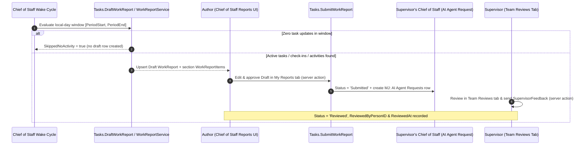

# BizApps Tasks — Work Bus Extensions, Field Suggestions & 15Five Work Reports Guide

This guide documents how **BizApps Tasks** acts as the universal **Work Bus** across MemberJunction Open Apps — enabling external systems (such as `bizapps-tasks-github`) to extend `Task` via declarative IS-A subtypes, surfacing reviewable `FIELD_SUGGESTION` proposals on task records, and powering daily **15Five Work Reports** inside **Chief of Staff**.

---

## 1. Declarative IS-A Subtype Extensions (`TaskType.ExtensionEntity`)

Rather than copying external issue/PR columns onto `__mj_BizAppsTasks.Task` or writing imperative subclass hooks per connector, `TaskType` exposes a nullable `ExtensionEntity NVARCHAR(255)` column paired with MemberJunction 6.3's declarative `Entity.SubtypeSelector` metadata on `MJ_BizApps_Tasks: Tasks`:

```json
{
  "Path": "TypeID.ExtensionEntity",
  "AutoEnsureOnSave": true,
  "OnSubtypeChange": "Replace",
  "FoldIntoForm": true
}
```

### How It Works End-to-End

1. **Connector Open App Defines an IS-A Child Table**:
   A downstream Open App (for example `bizapps-tasks-github`) creates a table whose `ID UNIQUEIDENTIFIER NOT NULL PRIMARY KEY` is a foreign key to `__mj_BizAppsTasks.Task(ID)` (such as `GitHubIssueTask` or `GitHubPullRequestTask`).
   - **Important Schema Requirement for `AutoEnsureOnSave: true`**: Because `BaseEntity` provisions the companion child row automatically via zero-argument `EnsureISAChild()` when a `Task` is saved, every non-PK column on an IS-A child table participating in `AutoEnsureOnSave` **must be nullable or have a `DEFAULT` constraint** so initial auto-creation succeeds before connector-specific fields are populated.
2. **Seeded `TaskType` Declares `ExtensionEntity`**:
   The downstream app seeds a `TaskType` row (e.g., `Code = 'GITHUB_ISSUE'`, `ExtensionEntity = 'MJ_BizApps_Tasks_GitHub: GitHub Issue Tasks'`).
   - **Operational Guidance**: Treat `TaskType.ExtensionEntity` as immutable once a `TaskType` is in production use. Rather than mutating `ExtensionEntity` on an existing `TaskType` that already has `Task` rows, introduce a new `TaskType` row for the new subtype.
3. **MJ Core `BaseEntity` Handles Provisioning, Validation & Forms Automatically (MJ 6.3+)**:
   - **Validation**: Saving a `TaskType` with an `ExtensionEntity` that is not a declared IS-A child of `MJ_BizApps_Tasks: Tasks` is rejected automatically by `BaseEntity.Validate()`.
   - **Auto-Provisioning (`AutoEnsureOnSave: true`)**: Saving a `Task` whose `TypeID` resolves an `ExtensionEntity` automatically provisions the companion IS-A child row in the same save transaction via zero-argument `EnsureISAChild()`.
   - **Subtype Replacement (`OnSubtypeChange: "Replace"`)**: Reassigning `TypeID` on an existing task to a type backed by a different `ExtensionEntity` replaces the previous child row rather than blocking saves on existing tasks.
   - **Form Folding (`FoldIntoForm: true`)**: Standard MJ record forms render the active subtype's fields inline within the `Task` form without custom per-connector form code.
   - **Pre-6.3 Host Compatibility**: Package dependencies compile against MJ `6.2.1` while MJ `6.3` is pre-release. On a `6.2.1` runtime host, `TaskType.ExtensionEntity` and the `SubtypeSelector` / `Comments` JSON metadata are stored in the database and activate automatically as soon as the host upgrades to MJ `6.3` (`MJ#6491`).

---

## 2. Field Suggestions on Tasks (`FIELD_SUGGESTION`)

`MJ_BizApps_Tasks: Tasks` enables core MemberJunction comments and structured field suggestions in `Entity.Configuration`:

```json
{
  "Comments": {
    "Enabled": true,
    "AllowedCommentTypes": ["COMMENT", "FIELD_SUGGESTION"]
  }
}
```

- Agents, sync connectors, and LLM inference prompts propose changes to task fields (`DueAt`, `HoursEstimated`, `ParentID`, `Priority`, etc.) by creating `MJ: Field Suggestions` records (`AnchorType = 'field'`, `AnchorKey = '<FieldName>'`, `SuggestedValue`, `Confidence`, `Source`) linked to `MJ_BizApps_Tasks: Tasks`.
- Humans review and accept or reject suggestions inline in the task record form or conversation thread, preserving provenance (`Outcome = 'Accepted' | 'Rejected' | 'Superseded'`, `ResolvedByUserID`, `ResolvedAt`).
- `<bizapps-task-list>` queries `LoadPendingFieldSuggestionCountsForTasks()` (via `EntityByName`) to render per-row suggestion count chips and a toolbar **Suggestions** filter toggle (`[PendingSuggestionsOnly]`). On a pre-6.3 host where `MJ: Field Suggestions` is not registered, `LoadPendingFieldSuggestionCountsForTasks()` logs a diagnostic status message and returns an empty map cleanly.

---

## 3. 15Five Work Reports & Supervisor Review Loop

`WorkReport` and `WorkReportItem` implement the 15Five methodology ("fifteen minutes to write — closer to five with Chief of Staff drafting — five minutes for your supervisor to read and respond").



### Schema Summary (`__mj_BizAppsTasks`)

| Table | Entity Name | Purpose |
| :--- | :--- | :--- |
| `WorkReport` | `MJ_BizApps_Tasks: Work Reports` | Header record (`PersonID`, `PeriodStart`, `PeriodEnd`, `Title`, `Body`, `Status` `'Draft' \| 'Submitted' \| 'Reviewed'`, `AuthoredByAgentRunID`, `SupervisorFeedback`, `ReviewedByPersonID`, `ReviewedAt`) with `CK_WorkReport_Period` (`PeriodEnd >= PeriodStart`) and `UQ_WorkReport_Person_Period` (`UNIQUE (PersonID, PeriodStart, PeriodEnd)`) |
| `WorkReportItem` | `MJ_BizApps_Tasks: Work Report Items` | Structured line items (`WorkReportID`, `TaskID`, `Section` `'Completed' \| 'InProgress' \| 'Next' \| 'Blockers' \| 'AtRisk'`, `Summary`, `Sequence`) |

### Server-Side Authorization, RLS & Fail-Closed Identity

1. **Row-Level Security (`RowLevelSecurityFilter`)**:
   - `UI: Work Reports - Author or Supervisor Chain` (`DC505938-81AC-4EFF-A6FF-99BFB5B11018`) and `UI: Work Report Items - Author or Supervisor Chain` (`E2D9FE26-3490-48C5-A60B-42F1B2973B19`) restrict `UI`-role read/update access on `Work Reports` and `Work Report Items` to the report author (`MJ_BizApps_Common: People`) and their direct/indirect supervisor chain across `People.SupervisorPersonID` and `MJ: Employees.SupervisorID` (`CanDelete` on `Work Report Items` is disabled for the `UI` role).
2. **Server-Side Entity Subclass (`WorkReportEntityServer`)**:
   - Registered on `MJ_BizApps_Tasks: Work Reports` in `@mj-biz-apps/tasks-entities-server` with `DefaultSkipAsyncValidation = false`.
   - Enforces on every server save that new reports start in `'Draft'` for the caller's own `PersonID`, `'Draft'` reports may only be edited or transitioned to `'Submitted'` by their author, `'Submitted'` reports may only transition to `'Reviewed'` with non-empty `SupervisorFeedback` by the author's resolved supervisor (never self-reviewed), and `'Reviewed'` reports are locked against further edits.
3. **Fail-Closed Reporting Line Resolution (`MJ: Employees.SupervisorID`)**:
   - `WorkReportService.ResolveSupervisorChainForPerson()` and `ResolveDirectReportPersonIDs()` check `.Success` on every `RunView` in the resolution chain and throw on any query error.
   - `DraftWorkReport`, `SubmitWorkReport`, and `RecordSupervisorReview` refuse unless the caller is positively resolved to an active `Person` matching the required author or mapped supervisor role.
4. **Local Calendar Window & Inclusive End-of-Day Normalization**:
   - `GetLocalDayWindow()` computes the caller's local calendar day (`00:00:00.000` to `23:59:59.999` local time).
   - `NormalizeReportPeriodWindow()` expands any date-only or midnight `PeriodEnd` (including multi-day windows such as `2026-11-02..2026-11-06`) to `23:59:59.999` of the final day so activity on the last day of the period is never dropped, and `DraftWorkReport` reuses an existing `Draft` for the same `(PersonID, PeriodStart, PeriodEnd)` period instead of creating duplicates.

### Shipped Chief of Staff Integration & Teardown

- **Skill**: `"Work reports"` (`MJ: AI Skills`), granted to `Chief of Staff` via `MJ: AI Agent Skills`.
- **Server Actions**: `Draft Work Report` (`Tasks.DraftWorkReport`), `Submit Work Report` (`Tasks.SubmitWorkReport`), and `Review Work Report` (`Tasks.ReviewWorkReport`) delegate directly to `WorkReportService.Instance` on the server (`AuthorizesCaller = true`).
- **Navigation Surface**: `NavItem.bizapps-tasks.work-reports` in `MJ: Application Settings` mounts `ChiefOfStaffWorkReportsResource` (`BizAppsTasksChiefOfStaffWorkReports`) inside Chief of Staff. Draft, Submit, and Review invoke the server actions via `GraphQLActionClient`, and the UI banner only claims supervisor notification when `SupervisorNotified === true`.
- **Clean Uninstall**: `teardown/V1__Remove_Work_Reports_Extension.sql` (and `teardown-pg/V1__Remove_Work_Reports_Extension.pg.sql`) removes dependent `ActionExecutionLog`, `AIAgentAction`, `EntityActionParam`, `EntityActionFilter`, `EntityAction`, `ActionAuthorization`, `ActionResultCode`, `ActionParam`, `Action`, `RowLevelSecurityFilter`, Chief of Staff `NavItem`, and `"Work reports"` skill rows when `mj app remove bizapps-tasks` runs.
