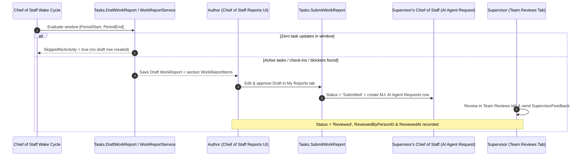

# BizApps Tasks — Work Bus Extensions, Field Suggestions & 15Five Work Reports Guide

This guide documents how **BizApps Tasks** acts as the universal **Work Bus** across MemberJunction Open Apps — enabling external systems (such as `bizapps-tasks-github`) to extend `Task` via declarative IS-A subtypes, surfacing reviewable `FIELD_SUGGESTION` proposals on task records, and powering daily **15Five Work Reports** inside **Chief of Staff**.

---

## 1. Declarative IS-A Subtype Extensions (`TaskType.ExtensionEntity`)

Rather than copying external issue/PR columns onto `__mj_BizAppsTasks.Task` or writing imperative subclass hooks per connector, `TaskType` exposes a nullable `ExtensionEntity NVARCHAR(255)` column paired with MemberJunction 6.3's declarative `Entity.SubtypeSelector` metadata on `MJ_BizApps_Tasks: Tasks`:

```json
{
  "Path": "TypeID.ExtensionEntity",
  "AutoEnsureOnSave": true,
  "OnSubtypeChange": "Refuse",
  "FoldIntoForm": true
}
```

### How It Works End-to-End

1. **Connector Open App Defines an IS-A Child Table**:
   A downstream Open App (for example `bizapps-tasks-github`) creates a table whose `ID UNIQUEIDENTIFIER NOT NULL PRIMARY KEY` is a foreign key to `__mj_BizAppsTasks.Task(ID)` (such as `GitHubIssueTask` or `GitHubPullRequestTask`).
2. **Seeded `TaskType` Declares `ExtensionEntity`**:
   The downstream app seeds a `TaskType` row (e.g., `Code = 'GITHUB_ISSUE'`, `ExtensionEntity = 'MJ_BizApps_Tasks_GitHub: GitHub Issue Tasks'`).
3. **MJ Core `BaseEntity` Handles Provisioning, Validation & Forms Automatically**:
   - **Validation**: Saving a `TaskType` with an `ExtensionEntity` that is not a declared IS-A child of `MJ_BizApps_Tasks: Tasks` is rejected automatically by `BaseEntity.Validate()`.
   - **Auto-Provisioning (`AutoEnsureOnSave: true`)**: Saving a `Task` whose `TypeID` resolves an `ExtensionEntity` automatically provisions the companion IS-A child row in the same save transaction via zero-argument `EnsureISAChild()`.
   - **Immutability (`OnSubtypeChange: "Refuse"`)**: Reassigning `TypeID` to a type backed by a different `ExtensionEntity` once the subtype row exists is refused cleanly.
   - **Form Folding (`FoldIntoForm: true`)**: Standard MJ record forms render the active subtype's fields inline within the `Task` form without custom per-connector form code.

---

## 2. Field Suggestions on Tasks (`FIELD_SUGGESTION`)

`MJ_BizApps_Tasks: Tasks` enables core MemberJunction comments and structured field suggestions in `Entity.Configuration`:

```json
{
  "Comments": {
    "Enabled": true,
    "AllowedCommentTypes": ["COMMENT", "FIELD_SUGGESTION"]
  }
}
```

- Agents, sync connectors, and LLM inference prompts propose changes to task fields (`DueAt`, `HoursEstimated`, `ParentID`, `Priority`, etc.) by creating `MJ: Field Suggestions` records (`AnchorType = 'field'`, `AnchorKey = '<FieldName>'`, `SuggestedValue`, `Confidence`, `Source`) linked to `MJ_BizApps_Tasks: Tasks`.
- Humans review and accept or reject suggestions inline in the task record form or conversation thread, preserving provenance (`Outcome = 'Accepted' | 'Rejected' | 'Superseded'`, `ResolvedByUserID`, `ResolvedAt`).
- `<bizapps-task-list>` queries `LoadPendingFieldSuggestionCountsForTasks()` to render per-row suggestion count chips and a toolbar **Suggestions** filter toggle (`[PendingSuggestionsOnly]`).

---

## 3. 15Five Work Reports & Supervisor Review Loop

`WorkReport` and `WorkReportItem` implement the 15Five methodology ("fifteen minutes to write — closer to five with Chief of Staff drafting — five minutes for your supervisor to read and respond").



### Schema Summary (`__mj_BizAppsTasks`)

| Table | Entity Name | Purpose |
| :--- | :--- | :--- |
| `WorkReport` | `MJ_BizApps_Tasks: Work Reports` | Header record (`PersonID`, `PeriodStart`, `PeriodEnd`, `Title`, `Body`, `Status` `'Draft' \| 'Submitted' \| 'Reviewed'`, `AuthoredByAgentRunID`, `SupervisorFeedback`, `ReviewedByPersonID`, `ReviewedAt`) with `CK_WorkReport_Period` (`PeriodEnd >= PeriodStart`) |
| `WorkReportItem` | `MJ_BizApps_Tasks: Work Report Items` | Structured line items (`WorkReportID`, `TaskID`, `Section` `'Completed' \| 'InProgress' \| 'Next' \| 'Blockers' \| 'AtRisk'`, `Summary`, `Sequence`) |

### Reporting Line Resolution (`MJ: Employees.SupervisorID`)

`WorkReportService.ResolveSupervisorChainForPerson()` and `ResolveDirectReportPersonIDs()` resolve reporting lines directly from core MJ's `MJ: Employees.SupervisorID` hierarchy — matching `MJ: Employees.Email` case-insensitively to `MJ: Users` and `MJ_BizApps_Common: People` — so no duplicate supervisor column is stored on `People`.

### Shipped Chief of Staff Integration & Teardown

- **Skill**: `"Work reports"` (`MJ: AI Skills`), granted to `Chief of Staff` via `MJ: AI Agent Skills`.
- **Actions**: `Draft Work Report` (`Tasks.DraftWorkReport`), `Submit Work Report` (`Tasks.SubmitWorkReport`), and `Review Work Report` (`Tasks.ReviewWorkReport`).
- **Navigation Surface**: `NavItem.bizapps-tasks.work-reports` in `MJ: Application Settings` mounts `ChiefOfStaffWorkReportsResource` (`BizAppsTasksChiefOfStaffWorkReports`) inside Chief of Staff. Only read/filter/navigation client tools are exposed to the co-agent; submitting a report or sending supervisor feedback always requires explicit human click confirmation.
- **Clean Uninstall**: `teardown/V1__Remove_Work_Reports_Extension.sql` (and `teardown-pg/V1__Remove_Work_Reports_Extension.pg.sql`) removes the Chief of Staff `NavItem`, `"Work reports"` skill grant, and Work Report action registrations when `mj app remove bizapps-tasks` runs.
