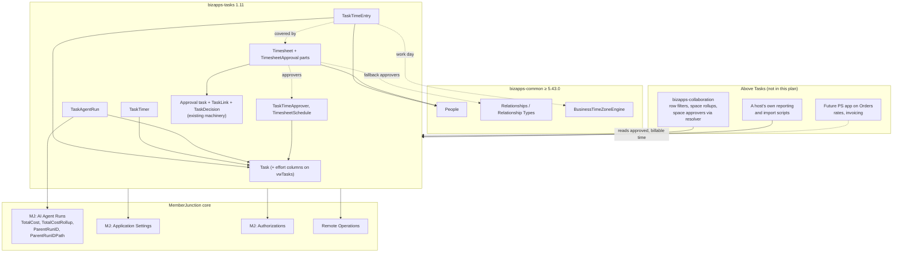
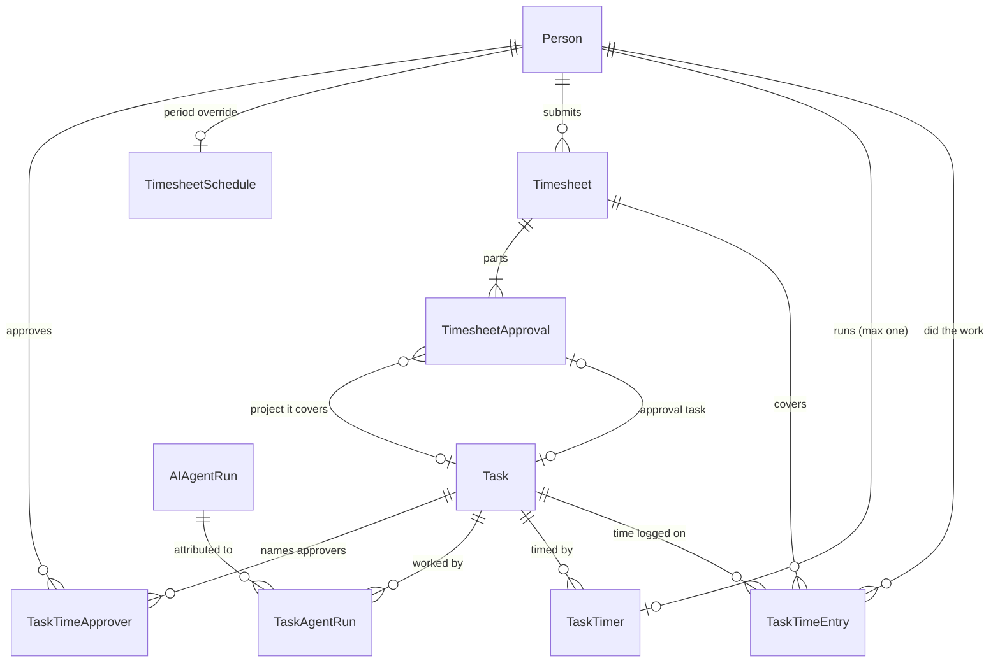
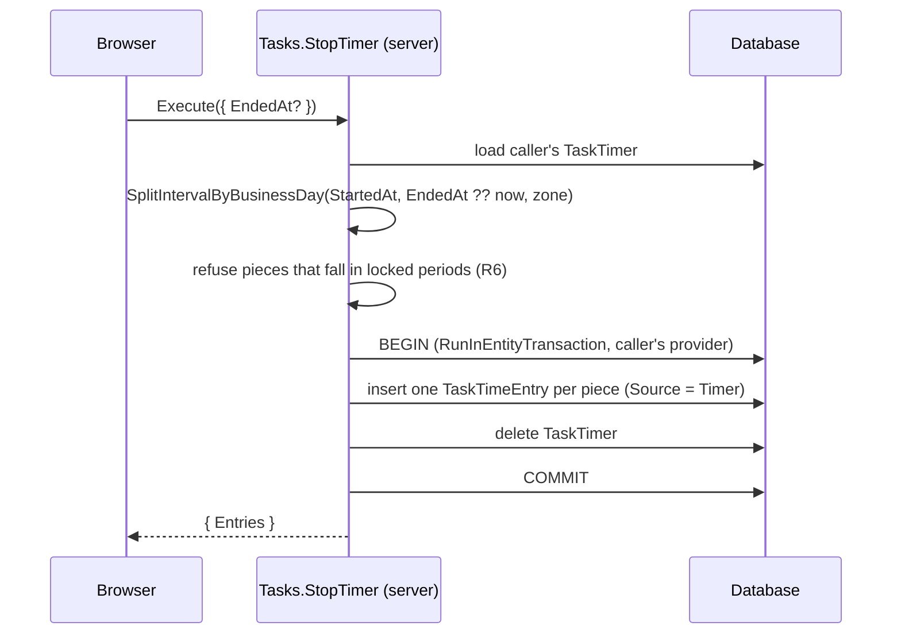
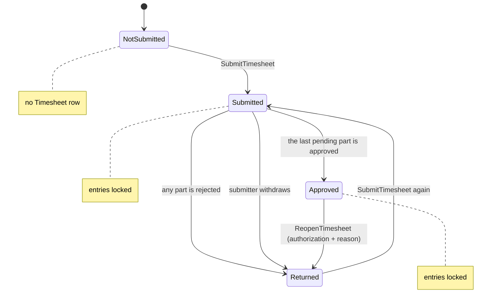

# Time Tracking in BizApps Tasks: Implementation Plan

| | |
|---|---|
| **Status** | Proposed. This is a plan-only PR for review; no code is written until it is approved. |
| **Ships as** | `mj-bizapps-tasks` **1.11.0**, one additive minor release. |
| **Replaces** | The "Time logging" backlog item in [BIZAPPS_TASKS_PLAN.md §5](BIZAPPS_TASKS_PLAN.md#5-scope--backlog). With it, a host can retire a separate time-tracking product. |
| **Floors** | MemberJunction stays at 6.1.6. bizapps-common rises from 5.33.1 to **5.43.0**, for `BusinessTimeZoneEngine` (D5). |
| **Date** | 2026-11-03 |

## How to review this plan

- §3 holds the decisions, D1 to D19. Each one names the alternative it rejected. Comment on the
  decision you disagree with; everything after §3 follows from those decisions.
- §15 lists the open questions, the places where a reviewer's answer changes what gets built.
- [Appendix A](#appendix-a-how-this-plan-differs-from-the-original-spec) lists every way this plan
  departs from the original time-tracking spec, and why.

## Contents

1. [Summary](#1-summary)
2. [Goals and non-goals](#2-goals-and-non-goals)
3. [Decisions](#3-decisions)
4. [Architecture](#4-architecture)
5. [Data model](#5-data-model)
6. [Server behaviour](#6-server-behaviour)
7. [API surface](#7-api-surface)
8. [User interface](#8-user-interface)
9. [Reporting](#9-reporting)
10. [Permissions and security](#10-permissions-and-security)
11. [Testing](#11-testing)
12. [Changes outside this repo](#12-changes-outside-this-repo)
13. [Build sequence](#13-build-sequence)
14. [Acceptance criteria](#14-acceptance-criteria)
15. [Open questions](#15-open-questions)
16. [Risks](#16-risks)
- [Appendix A: How this plan differs from the original spec](#appendix-a-how-this-plan-differs-from-the-original-spec)
- [Appendix B: Files this plan touches or cites](#appendix-b-files-this-plan-touches-or-cites)

---

## 1. Summary

Tasks gains an **effort ledger**:

- People log time against tasks, with a timer or by hand.
- Agent runs are linked to the tasks they worked on.
- Every task shows human hours and agent cost side by side, for itself and its subtree.

The agent figures come from MemberJunction's own `MJ: AI Agent Runs` records. No cost or token data
is copied.

It also adds **timesheets**. A person submits a period of time: a week by default, or bi-weekly,
semi-monthly, monthly or open-ended, set per host and per person. Each project the time touches
approves its own part, through Tasks' existing approval machinery: an approval task, the Approvals
inbox, and task decisions. The timesheet is approved only when every part is approved, like the
required checks on a pull request. A submitted or approved period locks its entries.

All of it is **off by default**, behind two Tasks settings. Hosts that use Tasks for workflow and
approvals see no change. **Billing, rates and invoicing stay out of Tasks.**

| What ships in 1.11.0 | |
|---|---|
| **Data** | `TaskTimeEntry`, `TaskTimer`, `TaskAgentRun`, `Timesheet`, `TimesheetApproval` (one per part), `TaskTimeApprover`, `TimesheetSchedule`; effort columns on `vwTasks`; `TaskType.RequiresAssigneeDecision`; the Timesheet Approval task type |
| **Server** | Time entry rules, timer operations, agent-run linking, effort read; periods; finding each project's approvers; submit, withdraw and reopen; gathering part outcomes; locking |
| **UI** | Timer, log-time dialog, effort section on the task, task form panel; My Time with week and period views, submit and status; project approvers on the task; part summary and approve-all by project in Approvals |
| **Reporting** | Five queries: by person and day, by root task and day, effort mix by root task, by person and timesheet period, parts awaiting a decision |
| **Settings** | `TimeTrackingEnabled`, `TimesheetApprovalEnabled`, period settings, fallback approver settings |

---

## 2. Goals and non-goals

### Goals

1. A person can log time against any task they can see, by timer or by hand, and edit or delete
   their own entries.
2. Each person has at most one running timer, and sees it wherever they work in Tasks.
3. A weekly grid (tasks × days) that loads and saves a person's week.
4. Agent runs are attributed to tasks, and each task shows run count, tokens, cost and duration,
   read from MJ's run records.
5. Human hours and agent effort appear side by side on a task, and rolled up over its subtask tree.
6. Reporting queries: hours by person and day, hours by root task, and the mix of human hours and
   agent cost by root task.
7. **Timesheets:** a person submits a period of time, weekly by default, or bi-weekly, semi-monthly,
   monthly or open-ended, set per host or per person. Each project approves its own part, and the
   timesheet is approved only when every part is. Submitted and approved periods lock, and an
   authorized person can reopen one. No billing.
8. Optional: off by default, and no visible change on a host that does not turn it on.

### Non-goals, and where each one goes instead

| Not in this plan | Where it goes |
|---|---|
| Rates, billing, invoicing, time & materials | A future professional-services app built on bizapps-orders, as a time-and-materials product type. Tasks keeps only what such an app would read: approved timesheets and `IsBillable`. |
| Rollups by Collaboration space or client | A host's own reporting, or a Collaboration follow-up (§12.2). Tasks cannot see spaces (D17). |
| Importing history from another time tracker | A host's own script (§12.3). The schema leaves room for it: `Source = 'Import'`, `SourceSystem`, `ExternalID`. |
| Capacity, utilization targets, PTO, overtime | Not planned. |
| Multi-level approval chains (for example a project lead, then a line manager, in sequence) | Not planned. A timesheet's parts are approved in parallel, one approval per project (D12), not in sequence. |
| Time logged directly against records other than tasks | Not needed. An issue's work is done in tasks, so time on an issue is time on its tasks (D2). |

---

## 3. Decisions

### D1. Time tracking lives in bizapps-tasks, behind settings that are off by default

**Why.** Time tracking is part of how people use a task manager: Jira has work logs, and Asana and
ClickUp have built-in time tracking. Building it inside Tasks has four concrete advantages:

- The timer goes straight into Tasks' own components: cards, detail panel, My Tasks, and the
  kanban and Gantt views that Collaboration renders. No extension hooks are needed.
- `Task.HoursEstimated` already exists, so estimate against actual is a task concern.
- The data has one owner.
- Tasks already has the approval machinery that timesheets need (D10).

**Rejected: a separate `bizapps-time` app on top of Tasks.**

- Its main benefit was keeping timers out of hosts that use Tasks only for approvals. Settings that
  are off by default give the same result (D16).
- It would need new UI extension hooks in Tasks.
- It would need its own subclass of `TaskEntityServer` next to Collaboration's. With two subclasses
  of one class, one of them silently loses.
- It would add a second release train. Apps that depend on Tasks declare `>=1.x <2.0.0`, so an
  additive Tasks minor forces none of them to release.

### D2. Time hangs off a task: `TaskID` is required

- **Issues are already covered.** bizapps-issues does its work in tasks it creates and links back
  with `TaskLink` (bizapps-issues `plans/IMPLEMENTATION_PLAN.md`), so time on an issue is time on
  those tasks. There is no `IssueID` column, and none is needed.
- **Time outside any project** (admin, internal meetings) goes on an ordinary task, such as
  "Internal: admin". There is no special concept for it.

### D3. People, not users

The person who did the work is `PersonID`, a foreign key to `__mj_BizAppsCommon.Person`. That matches
every other "who" column in Tasks: `Task.CreatedByPersonID`, `TaskComment.PersonID`,
`TaskDecision.DecidedByPersonID`.

The server finds the signed-in user's Person with `PrimaryPersonIDForUser`
(`packages/EntitiesServer/src/UserPeople.ts`), the same helper `TaskEntityServer` uses to stamp a
task's creator. A user with no Person, such as a service account, cannot log time as themselves, and
gets a refusal that says so.

### D4. A running timer is its own table, with one row per person

`TaskTimer` holds the running timer, and `UNIQUE (PersonID)` *is* the "one running timer per person"
rule. Stopping the timer turns it into time entries (D5). Every `TaskTimeEntry` is therefore complete,
with a duration.

**Rejected: a time entry with `EndedAt IS NULL`.**

- `DurationMinutes` would have to be nullable.
- Every total, rollup and lock rule would have to exclude half-finished entries.
- "One per person" would need a filtered unique index. That means `QUOTED_IDENTIFIER` handling, and a
  harder PostgreSQL conversion.

### D5. A stopped timer becomes one entry per business day

A work day is a calendar day in the **business time zone** (`BusinessTimeZoneEngine.Zone` from
`@mj-biz-apps/common-entities`). A timer that runs past midnight is split, so each entry lands on the
right day and in the right timesheet period.

The engine first shipped in bizapps-common **5.43.0**, so Tasks raises its Common floor to match (in
`mj-app.json`, peer dependencies and dev dependencies).

### D6. Totals are read, not stored, and `HoursActual` is left alone

- **Per-task totals** are columns on `vwTasks`, computed when the view is read. That is the same
  pattern as the existing `AssignmentsCount` and `CommentsCount` (§5.5).
- **Subtree totals** come from one server read, `Tasks.GetTaskEffort` (§6.4).
- **Logging time never writes the `Task` row.**

**Why not store them.**

- A Task save is expensive. It fires TaskType lifecycle action hooks, activity logging, the parent
  progress rollup, Collaboration's validation, and record-change history. Logging 15 minutes should
  do none of that.
- Agent cost keeps changing after a run is linked, while the run is still going, so a stored copy
  would go stale.
- The parent `PercentComplete` rollup *is* stored, but for a reason hours lack: progress drives
  status (a parent completes automatically). Hours drive nothing.

**`HoursActual`** stays the hand-entered field it is today. While `TimeTrackingEnabled` is on, the
edit panel hides its input and shows logged hours instead. The server never writes it, so the field
has no second writer. Q1 asks whether to go further.

> This changes the lean in the discussion that led to this plan, which was to derive `HoursActual`
> from time entries. Deriving it would mean a Task save on every time entry, for the reasons above.

### D7. Agent effort is a link table, read from MJ's run records

**The link.** `TaskAgentRun (TaskID, AIAgentRunID)` records which task a run worked on.

It does **not** reuse `AIAgentRun.PrimaryScopeEntityID/RecordID`. That pair is the run's tenant: it
limits what the run may reach (`ActionRunScope`, MJ `packages/Actions/Base/src/ActionEngine-Base.ts`),
and agent memory lookups key on it. Pointing it at a task would change what the agent can see and
remember.

**What a run costs.**

- Cost including sub-agent runs is `COALESCE(TotalCostRollup, TotalCost)`. Tokens use the same
  expression on the token columns.
- BaseAgent adds in-process sub-agent runs' cost into the parent's `TotalCost` (MJ
  `packages/AI/Agents/src/base-agent.ts`).
- The `*Rollup` columns are written only for task-graph submissions, and are `NULL` otherwise.
- MJ's own documentation disagrees with itself about whether `TotalCost` includes sub-agent cost.
  slice A settles this with a fixture (§13).

**No double counting.**

- *Within one task*, the server keeps links non-nested:
  - Linking a run whose ancestor is already linked to the same task changes nothing; the ancestor
    already counts it.
  - Linking an ancestor of runs already linked to the task replaces those links with the ancestor.
  - So the per-task sum on `vwTasks` is exact.
- *Across tasks* (a subtree, a root task, a report), each run counts once. A run whose ancestor is
  also in the set does not count at all.
  - One pure function in `tasks-core` implements this, and it is unit-tested.
  - The root-task reporting view applies the same rule in SQL, using `ParentRunIDPath`, which has
    the form `'/<root>/…/<self>/'` (§5.5).

**Duration** is `CompletedAt − StartedAt`. A run still in progress counts the cost it has recorded so
far. Its duration counts toward no total until it completes, and the UI shows it as running.

### D8. Linking agent runs: by hand and by action now, automatically after an MJ change

**Now:**

- A person links one of their own recent runs from the task.
- An agent calls the **Link Agent Run to Task** action with the run ID.

**After MJ change 1 (small).** `RunActionParams.AgentRunID`, set by BaseAgent on each action call.
The action then defaults to the calling run (§12.1).

**After MJ change 2.** An ambient agent-run context (`AsyncLocalStorage`; MJ already uses it for
transaction affinity and entity-action dispatch). Tasks' server classes then link automatically
whenever an agent run saves a task, check-in, comment or time entry. That covers agents that touch
tasks through generic record actions, which is how the Chief of Staff agent works.

**Rejected: deriving links after the fact.** `MJ: AI Agent Run Steps` record which run executed which
action log. But `MJ: Action Execution Logs` has no target record for an action an agent calls
directly, so a job would have to parse `Params` JSON to find the task. That is too fragile.

### D9. Writes that touch several rows are Remote Operations

These operations write several rows and must succeed or fail as a whole:

- starting and stopping a timer;
- submitting, withdrawing and reopening a timesheet.

They become MJ **Remote Operations**: a metadata row, a CodeGen'd typed class the browser calls, and a
server subclass whose work runs in `RunInEntityTransaction` on the caller's provider. That is the
pattern bizapps-accounting, bizapps-orders and bizapps-caliber use at MJ 6.1.6. These are Tasks'
first Remote Operations, so slice A adds the `RemoteOperations` CodeGen output to `mj.config.cjs`.

Single-row writes stay plain entity saves, with their rules in server subclasses: logging, editing
or deleting an entry, discarding a timer, and linking a run.

### D10. Timesheets are approved through Tasks' own approval machinery

Submitting a period does this for each **part** of the timesheet (D12):

1. It creates a **Timesheet Approval** task: TaskType `Code = 'TIMESHEET_APPROVAL'`,
   `IsApproval = 1`, created with `TaskOrchestrationService.CreateApprovalRequest`.
2. It links that task to the part with `TaskLink`.
3. It assigns that part's approvers.

From there, the existing machinery takes over:

- The task appears in each approver's **Approvals** inbox automatically, because the inbox lists
  every approval task type.
- A decision is a `TaskDecision`.
- The history is the approval task's activity log.

Forms uses the same pattern for form review: the app owns the record's states, and Tasks owns
assignment, decisions, the inbox and the audit trail.

**Rejected: making a timesheet a kind of Task.** A timesheet is a period, not a piece of work. It
would show up in every task list, kanban and Gantt.

### D11. The submission period is configurable, per host and per person

**Period types.**

| Type | A period is |
|---|---|
| `Weekly` (default) | Seven days from the configured start day. |
| `BiWeekly` | Fourteen days, aligned to an anchor date that starts some period. |
| `SemiMonthly` | The 1st to the 15th, and the 16th to the end of the month. |
| `Monthly` | A calendar month. |
| `OpenEnded` | From the day after the person's last submitted period, to an end date the person picks when submitting. |

**Who it applies to.**

- A host setting sets the default type (§5.7).
- A `TimesheetSchedule` row overrides it for one person.
- Holders of **Manage Timesheets** set anyone's schedule. People set their own when the host turns
  on `TimesheetSchedulesSelfService`.

**How periods behave.**

- Every timesheet stores its own `PeriodStart`, `PeriodEnd` and `PeriodType`. Locking, reporting
  and history read the stored dates, never the current schedule.
- A person's periods never overlap.
  - When a person's type changes, the first new period is a transition: it starts the day after
    their last submitted period and ends where the new type's period ends.
  - Open-ended periods are contiguous by construction.
- Calendar periods (all types but `OpenEnded`) can be submitted in any order. A period with no time
  can be submitted, to confirm that no time was worked (Q6).
- The pure function `PeriodFor(date, schedule, submittedPeriods)` in `tasks-core` computes all of
  this, so the browser and the server agree.
- **A timesheet row exists only once a period has been submitted.** An unsubmitted period is just
  entries, so reading a period never creates rows.

### D12. Each project approves its own part, and every part must be approved

**The project is the root of a task tree** (Tasks' own guide models projects this way:
`guides/TASK_WORKFLOW_AND_LIFECYCLE_GUIDE.md` §5). A Collaboration space sits above that: it holds
any number of root tasks, and its sub-spaces hold their own. Not every root task is a project.
Standalone tasks, objectives and other apps' workflow tasks are root tasks too. That does not matter
here: only tasks that name approvers do.

**Naming approvers.** `TaskTimeApprover (TaskID, PersonID)` names who approves time on a task and
everything below it. It is usually set on a root task. Approvers are not task assignments, so naming
someone fires no assignment notification or hook, and does not put the project in their My Tasks
list.

**Finding the approvers for an entry.** Take the first source that yields anyone:

1. **The task chain.** Walk up from the entry's task to the first task that names approvers. A root
   task covers its whole tree, and a large sub-project can name its own approvers.
2. **Registered resolvers.** A `BaseTimeApproverResolver` extension point, registered through
   ClassFactory and consulted in priority order. An app above Tasks plugs in here without Tasks
   knowing it exists. For example, Collaboration could supply approvers named on a space for the
   root tasks filed in it (§12.2).
3. **The person's own approver.**
   - `TimesheetApproverRelationshipType` names a person-to-person Common relationship type. The
     approver is the `ToPersonID` of an active relationship whose `FromPersonID` is the submitter.
     Common ships no reporting type between people, so a host that wants managers to approve adds
     one, such as "Reports To", as metadata.
   - Failing that, `TimesheetApproverRole` names an MJ role whose holders approve.

The submitter is removed at every step; a step that is left with no one passes to the next. If an
entry has no approver at all, the submit is refused, naming the task.

**Parts.** Submitting groups the period's entries by the source that approves them, so each project
is one part, and the person's own approver is one part. Each part gets a `TimesheetApproval` row and
its own approval task.

- **The timesheet is approved only when every part is approved**, like the required checks on a pull
  request. Until then it is `Submitted`.
- **If any part is rejected, the whole timesheet returns to the person.**
  - The other parts' pending approval tasks are cancelled with a note saying why, so no approver
    acts on a stale request.
  - Parts already approved keep their approval.
- **On resubmit,** a part whose entries are unchanged since it was approved keeps its approval. The
  comparison uses a snapshot hash of the part's entries. Every other part gets a new approval task.
  - The setting `TimesheetResubmitReapprovesAll` makes every part approve again, like dismissing
    stale approvals on a protected branch (Q10).
- **Each approver sees only their part.** A project lead sees the time logged on their project, not
  the person's time on other projects.

**Rejected alternatives.**

- *One approval for the whole timesheet:* every approver would see every project's time, and one
  person would answer for all of it.
- *One approval per project per period, across people:* fewer tasks for a lead, but it ties
  approval to everyone's submission timing, and one person's late timesheet would block the
  others'.

The cost of the chosen design is volume: a lead with six people on a project gets six approval tasks
each period. The Approvals inbox groups timesheet parts by project and offers **Approve all** (§8.5).

### D13. A timesheet decision must come from an assignee

This plan adds a TaskType flag, `RequiresAssigneeDecision`.

- The existing no-self-approval rule (`TaskDecisionEntityServer` with `TaskDecisionRefusal`) runs
  when the `PreventSelfApproval` setting is on **or** the task's type sets this flag.
- That rule means: the decider must be an assignee, and the decision is recorded as theirs.
- The Timesheet Approval type ships with the flag on.

This is a field on the task type, not code that compares type names, so Forms and Accounting can set
it on their own approval types.

### D14. Submitted and approved weeks are locked

A time entry dated on a day covered by the person's `Submitted` or `Approved` timesheet cannot be
created, changed, moved into or out of that period, or deleted, by anyone. An administrator reopens
the period first (§6.5). The time entry's server class enforces this.

### D15. Rights are authorizations, never role names

Two MJ authorizations sit under a new `Tasks` root:

- **Manage Time Entries:** log, edit or delete other people's entries; discard their timers; link
  their agent runs.
- **Manage Timesheets:** reopen an approved timesheet; name the approvers on a task; set a person's
  submission period.

The pattern is bizapps-collaboration's (`metadata/authorizations`, `metadata/authorization-roles`,
checked with `AuthorizationEvaluator().UserCanExecuteWithAncestors`). Default grants are in §10 and
Q5.

### D16. Settings hide the UI; the data is always accepted

| Setting | When it is off |
|---|---|
| `TimeTrackingEnabled` | No timer, no My Time page, no time sections, no effort columns shown. Plain time entry saves are still accepted, so imports and integrations can run before the UI is turned on. Timer operations refuse. |
| `TimesheetApprovalEnabled` | No submit and no approval UI. Submit, withdraw and reopen refuse. |

The server is the authority. The UI only hides things.

### D17. Rollups by space or client stay out of Tasks

Collaboration depends on Tasks, so Tasks cannot know about spaces. Tasks provides per-root-task
figures (§9). Collaboration files each task by its root (`SpaceItem` → root task), and a space can
hold many root tasks and sub-spaces, so a space total is one more join. That join belongs in a
Collaboration follow-up (§12.2) or in a host's own reporting.

### D18. One release

Everything in this plan ships together in **1.11.0**, with one migration and one changeset.

- Timesheets are part of what lets a host retire a separate time tracker. A ledger without them is
  half the product.
- The ledger and the locking rules are designed together in this plan, so nothing is gained by
  settling one before the other.
- The work is still reviewed in slices (§13), but it merges into `next` as one change, so no release
  carries part of it.

### D19. The global timer chip waits for an MJ extension point

Explorer has no registry that lets an app add something to the shell header:

- The header is fixed markup in explorer-core's `shell.component.html`.
- `BaseShellChromePolicy` can only hide chrome.
- `BaseUserMenu` registrations replace each other; the last one wins.
- A navigation-bar application button is a static icon.
- `ActivityService` is a background-job tracker, not a timer.

**Until then,** the running timer shows in the header of every Tasks page, on the task's card and in its
detail panel.

**An MJ PR** (§12.1) adds a `BaseShellHeaderItem` registry: every registration is rendered in the
header's `.header-actions`. Tasks registers its chip once that ships.

---

## 4. Architecture



### What each package gains

| Package | Adds |
|---|---|
| `@mj-biz-apps/tasks-entities` (shared) | Generated entity classes for the new tables; generated Remote Operation classes (`src/generated/remote_operations.ts`). |
| `@mj-biz-apps/tasks-core` (shared) | **Pure rules, unit-tested:** `SplitIntervalByBusinessDay`, `PeriodFor`, `TimeEntryRefusal`, `CountedAgentRuns`, `ResolveApprovers`, `GroupIntoParts`, `PartSnapshotHash`, `TimesheetStatusFromParts`. **Shared settings reader:** the keys and defaults move here, so browser and server read the same keys; `EntitiesServer` imports it from here (no re-export). **`TimeTrackingService`:** client-side verbs over entities and operations. |
| `@mj-biz-apps/tasks-entities-server` | Server classes `TaskTimeEntryEntityServer`, `TaskTimerEntityServer`, `TaskAgentRunEntityServer`, `TimesheetEntityServer`, `TimesheetApprovalEntityServer`, `TaskTimeApproverEntityServer`, `TimesheetScheduleEntityServer`, and the `BaseTimeApproverResolver` extension point. `TaskEntityServer` gains the approval-outcome step (§6.5) and a delete refusal for tasks with time entries. `TaskDecisionEntityServer` reads `RequiresAssigneeDecision`. |
| `@mj-biz-apps/tasks-server` | Remote Operation server classes and their `Load…` anchors; the timesheet reconcile sweep (a scheduled job beside `OverdueTaskNotificationJob`). |
| `@mj-biz-apps/tasks-actions` | **Link Agent Run to Task.** |
| `@mj-biz-apps/tasks-ng` | Timer UI; log-time dialog; effort section on the task; **My Time** page and section resource; time badges on cards; a Time panel on the Task entity form; period view and submit UI; time approvers on the task; an approval-subject extension point plus the timesheet part panel; approve-all by project in Approvals. |

---

## 5. Data model

### 5.1 Overview



**Naming.** The four tables that hang off a task follow Tasks' `Task*` prefix (`TaskTimeEntry`,
`TaskTimer`, `TaskAgentRun`, `TaskTimeApprover`). A timesheet hangs off a person and a period, so it
and its parts and schedule are `Timesheet`, `TimesheetApproval` and `TimesheetSchedule`. The entity
names follow, for example `MJ_BizApps_Tasks: Task Time Entries` and `… Timesheets`. Q7 invites other
names.

**Migration conventions.** These are the rules every Tasks migration follows: hardcoded schema
placeholders, no `__mj_*` timestamp columns, no indexes on foreign-key columns (CodeGen adds both),
`sp_addextendedproperty` on every column, and CodeGen output appended below the hand-written DDL.
The DDL below is a draft; the build PRs refine it.

### 5.2 `TaskTimeEntry`

```sql
CREATE TABLE ${flyway:defaultSchema}.TaskTimeEntry (
    ID              UNIQUEIDENTIFIER NOT NULL DEFAULT NEWSEQUENTIALID(),
    TaskID          UNIQUEIDENTIFIER NOT NULL,
    PersonID        UNIQUEIDENTIFIER NOT NULL,
    WorkDate        DATE             NOT NULL,
    DurationMinutes INT              NOT NULL,
    StartedAt       DATETIMEOFFSET   NULL,
    EndedAt         DATETIMEOFFSET   NULL,
    Notes           NVARCHAR(MAX)    NULL,
    IsBillable      BIT              NOT NULL DEFAULT 1,
    Source          NVARCHAR(20)     NOT NULL DEFAULT 'Manual',
    SourceSystem    NVARCHAR(80)     NULL,
    ExternalID      NVARCHAR(400)    NULL,
    CONSTRAINT PK_TaskTimeEntry PRIMARY KEY (ID),
    CONSTRAINT FK_TaskTimeEntry_Task   FOREIGN KEY (TaskID)   REFERENCES ${flyway:defaultSchema}.Task(ID),
    CONSTRAINT FK_TaskTimeEntry_Person FOREIGN KEY (PersonID) REFERENCES __mj_BizAppsCommon.Person(ID),
    CONSTRAINT CK_TaskTimeEntry_Duration CHECK (DurationMinutes BETWEEN 1 AND 1440),
    CONSTRAINT CK_TaskTimeEntry_Interval CHECK (
        (StartedAt IS NULL AND EndedAt IS NULL) OR
        (StartedAt IS NOT NULL AND EndedAt IS NOT NULL AND EndedAt > StartedAt)),
    CONSTRAINT CK_TaskTimeEntry_Source CHECK (Source IN ('Timer', 'Manual', 'Import')),
    CONSTRAINT CK_TaskTimeEntry_External CHECK (
        (SourceSystem IS NULL AND ExternalID IS NULL) OR
        (SourceSystem IS NOT NULL AND ExternalID IS NOT NULL))
);

-- Composite and lookup indexes. The single-column FK indexes come from CodeGen.
CREATE INDEX IX_TaskTimeEntry_Person_WorkDate ON ${flyway:defaultSchema}.TaskTimeEntry (PersonID, WorkDate);
CREATE INDEX IX_TaskTimeEntry_External        ON ${flyway:defaultSchema}.TaskTimeEntry (SourceSystem, ExternalID);
```

| Column | Meaning |
|---|---|
| `WorkDate` | The calendar day the work was done, in the business time zone. A timer stamps it per day (D5); a person types it for a manual entry. |
| `DurationMinutes` | Whole minutes, from 1 to 1440. Totals are always sums of this column. |
| `StartedAt` / `EndedAt` | Present when the entry came from a timer, or was entered as a start and end time. When present, the server derives `DurationMinutes` from them. Editing the duration of such an entry by hand clears both; `Source` stays as it was, because it records where the entry came from. |
| `IsBillable` | A plain flag. Nothing in Tasks acts on it. A future time-and-materials app (§2) would read it, and reports split on it. Q2 covers the default. |
| `Source` | `Timer`, `Manual` or `Import`. |
| `SourceSystem`, `ExternalID` | For a later import (§12.3), so it can be re-run safely: the source product's name and its own ID for the record. |

### 5.3 `TaskTimer`

```sql
CREATE TABLE ${flyway:defaultSchema}.TaskTimer (
    ID          UNIQUEIDENTIFIER NOT NULL DEFAULT NEWSEQUENTIALID(),
    PersonID    UNIQUEIDENTIFIER NOT NULL,
    TaskID      UNIQUEIDENTIFIER NOT NULL,
    StartedAt   DATETIMEOFFSET   NOT NULL,
    Notes       NVARCHAR(MAX)    NULL,
    IsBillable  BIT              NOT NULL DEFAULT 1,
    CONSTRAINT PK_TaskTimer PRIMARY KEY (ID),
    CONSTRAINT FK_TaskTimer_Person FOREIGN KEY (PersonID) REFERENCES __mj_BizAppsCommon.Person(ID),
    CONSTRAINT FK_TaskTimer_Task   FOREIGN KEY (TaskID)   REFERENCES ${flyway:defaultSchema}.Task(ID) ON DELETE CASCADE,
    CONSTRAINT UQ_TaskTimer_Person UNIQUE (PersonID)
);
```

- `Notes` and `IsBillable` carry over to the entries the timer becomes.
- Deleting the task deletes its running timers (`CASCADE`). A timer is not a record of work yet.
- **Record-change tracking is off** for this entity (set in entity metadata). It changes often and is
  temporary.

### 5.4 `TaskAgentRun`

```sql
CREATE TABLE ${flyway:defaultSchema}.TaskAgentRun (
    ID                UNIQUEIDENTIFIER NOT NULL DEFAULT NEWSEQUENTIALID(),
    TaskID            UNIQUEIDENTIFIER NOT NULL,
    AIAgentRunID      UNIQUEIDENTIFIER NOT NULL,
    LinkSource        NVARCHAR(20)     NOT NULL DEFAULT 'Manual',
    LinkedByPersonID  UNIQUEIDENTIFIER NULL,
    Notes             NVARCHAR(500)    NULL,
    CONSTRAINT PK_TaskAgentRun PRIMARY KEY (ID),
    CONSTRAINT FK_TaskAgentRun_Task       FOREIGN KEY (TaskID)       REFERENCES ${flyway:defaultSchema}.Task(ID) ON DELETE CASCADE,
    CONSTRAINT FK_TaskAgentRun_AIAgentRun FOREIGN KEY (AIAgentRunID) REFERENCES ${mjSchema}.AIAgentRun(ID) ON DELETE CASCADE,
    CONSTRAINT FK_TaskAgentRun_LinkedBy   FOREIGN KEY (LinkedByPersonID) REFERENCES __mj_BizAppsCommon.Person(ID),
    CONSTRAINT UQ_TaskAgentRun UNIQUE (TaskID, AIAgentRunID),
    CONSTRAINT CK_TaskAgentRun_LinkSource CHECK (LinkSource IN ('Manual', 'Action', 'Automatic'))
);
```

- A link is metadata about a run, so it is deleted along with its task or its run. If MJ ever prunes
  old runs, their links go too (§16).
- `LinkSource` records how the link was made: by a person (`Manual`), by the Link Agent Run to Task
  action (`Action`), or by the automatic linking that MJ change 2 enables (`Automatic`, D8).

### 5.5 Effort columns on `vwTasks`, and a helper view

`vwTasks` is maintained by hand on top of `vwTasksGenerated`. Its latest definition is in
`V202610171900__v1.9.x__Task_Priority_OKR_And_CheckIns.sql`. The migration drops and recreates
it with every existing column plus four new ones, and re-applies its grants:

```sql
    ISNULL(te.[LoggedMinutes], 0)   AS [LoggedMinutes],     -- this task's own entries
    ISNULL(ar.[AgentRunCount], 0)   AS [AgentRunCount],     -- this task's links (non-nested, D7)
    ISNULL(ar.[AgentCost], 0)       AS [AgentCost],         -- COALESCE(TotalCostRollup, TotalCost)
    ISNULL(ar.[AgentTokens], 0)     AS [AgentTokens]
...
LEFT OUTER JOIN (
    SELECT [TaskID], SUM([DurationMinutes]) AS [LoggedMinutes]
    FROM [${flyway:defaultSchema}].[TaskTimeEntry] GROUP BY [TaskID]
) AS te ON te.[TaskID] = g.[ID]
LEFT OUTER JOIN (
    SELECT l.[TaskID],
           COUNT(*) AS [AgentRunCount],
           SUM(COALESCE(r.[TotalCostRollup], r.[TotalCost], 0)) AS [AgentCost],
           SUM(COALESCE(r.[TotalTokensUsedRollup], r.[TotalTokensUsed], 0)) AS [AgentTokens]
    FROM [${flyway:defaultSchema}].[TaskAgentRun] l
    INNER JOIN [${mjSchema}].[AIAgentRun] r ON r.[ID] = l.[AIAgentRunID]
    GROUP BY l.[TaskID]
) AS ar ON ar.[TaskID] = g.[ID]
```

- **These sums are exact per task**, because the server keeps a task's links non-nested (D7).
- **`vwTaskRootAgentEffort`** is a helper view for reports by root task. It returns one row per root
  task and counted run, applying the across-tasks rule (D7): a run counts only when no ancestor run
  of it is linked anywhere in the same root task's tree. It uses `vwAIAgentRuns.ParentRunIDPath`
  (`'/<root>/…/<self>/'`).
  - slice A first confirms that column exists at the MJ 6.1.6 floor (§13).
  - If it does not, root-task agent figures come from `Tasks.GetTaskEffort` and the
    effort-mix query is dropped from this release.

### 5.6 Timesheet tables

```sql
-- One per person per submitted period.
CREATE TABLE ${flyway:defaultSchema}.Timesheet (
    ID                       UNIQUEIDENTIFIER NOT NULL DEFAULT NEWSEQUENTIALID(),
    PersonID                 UNIQUEIDENTIFIER NOT NULL,
    PeriodType               NVARCHAR(20)     NOT NULL,
    PeriodStart              DATE             NOT NULL,
    PeriodEnd                DATE             NOT NULL,
    Status                   NVARCHAR(20)     NOT NULL DEFAULT 'Submitted',
    SubmittedAt              DATETIMEOFFSET   NOT NULL,
    ApprovedAt               DATETIMEOFFSET   NULL,
    ReturnedAt               DATETIMEOFFSET   NULL,
    SubmittedMinutes         INT              NOT NULL,
    SubmittedBillableMinutes INT              NOT NULL,
    ReopenedAt               DATETIMEOFFSET   NULL,
    ReopenedByPersonID       UNIQUEIDENTIFIER NULL,
    ReopenReason             NVARCHAR(MAX)    NULL,
    CONSTRAINT PK_Timesheet PRIMARY KEY (ID),
    CONSTRAINT FK_Timesheet_Person     FOREIGN KEY (PersonID)           REFERENCES __mj_BizAppsCommon.Person(ID),
    CONSTRAINT FK_Timesheet_ReopenedBy FOREIGN KEY (ReopenedByPersonID) REFERENCES __mj_BizAppsCommon.Person(ID),
    CONSTRAINT UQ_Timesheet_Person_Period UNIQUE (PersonID, PeriodStart),
    CONSTRAINT CK_Timesheet_Period CHECK (PeriodEnd >= PeriodStart),
    CONSTRAINT CK_Timesheet_PeriodType CHECK (PeriodType IN ('Weekly', 'BiWeekly', 'SemiMonthly', 'Monthly', 'OpenEnded')),
    CONSTRAINT CK_Timesheet_Status CHECK (Status IN ('Submitted', 'Approved', 'Returned'))
);

-- One per part of a timesheet: a project, a resolver's scope, or the person's own approver.
CREATE TABLE ${flyway:defaultSchema}.TimesheetApproval (
    ID                       UNIQUEIDENTIFIER NOT NULL DEFAULT NEWSEQUENTIALID(),
    TimesheetID              UNIQUEIDENTIFIER NOT NULL,
    ScopeKey                 NVARCHAR(200)    NOT NULL,
    ScopeTaskID              UNIQUEIDENTIFIER NULL,
    ScopeLabel               NVARCHAR(255)    NOT NULL,
    Status                   NVARCHAR(20)     NOT NULL DEFAULT 'Pending',
    ApprovalTaskID           UNIQUEIDENTIFIER NULL,
    SubmittedMinutes         INT              NOT NULL,
    SubmittedBillableMinutes INT              NOT NULL,
    EntrySnapshotHash        NVARCHAR(64)     NOT NULL,
    DecidedAt                DATETIMEOFFSET   NULL,
    CONSTRAINT PK_TimesheetApproval PRIMARY KEY (ID),
    CONSTRAINT FK_TimesheetApproval_Timesheet    FOREIGN KEY (TimesheetID)    REFERENCES ${flyway:defaultSchema}.Timesheet(ID),
    CONSTRAINT FK_TimesheetApproval_ScopeTask    FOREIGN KEY (ScopeTaskID)    REFERENCES ${flyway:defaultSchema}.Task(ID),
    CONSTRAINT FK_TimesheetApproval_ApprovalTask FOREIGN KEY (ApprovalTaskID) REFERENCES ${flyway:defaultSchema}.Task(ID),
    CONSTRAINT UQ_TimesheetApproval_Scope UNIQUE (TimesheetID, ScopeKey),
    CONSTRAINT CK_TimesheetApproval_Status CHECK (Status IN ('Pending', 'Approved', 'Rejected', 'Cancelled'))
);

-- Who approves time on a task and everything below it. Usually set on a root task.
CREATE TABLE ${flyway:defaultSchema}.TaskTimeApprover (
    ID        UNIQUEIDENTIFIER NOT NULL DEFAULT NEWSEQUENTIALID(),
    TaskID    UNIQUEIDENTIFIER NOT NULL,
    PersonID  UNIQUEIDENTIFIER NOT NULL,
    CONSTRAINT PK_TaskTimeApprover PRIMARY KEY (ID),
    CONSTRAINT FK_TaskTimeApprover_Task   FOREIGN KEY (TaskID)   REFERENCES ${flyway:defaultSchema}.Task(ID) ON DELETE CASCADE,
    CONSTRAINT FK_TaskTimeApprover_Person FOREIGN KEY (PersonID) REFERENCES __mj_BizAppsCommon.Person(ID),
    CONSTRAINT UQ_TaskTimeApprover UNIQUE (TaskID, PersonID)
);

-- A person's own submission period, overriding the host default (D11).
CREATE TABLE ${flyway:defaultSchema}.TimesheetSchedule (
    ID            UNIQUEIDENTIFIER NOT NULL DEFAULT NEWSEQUENTIALID(),
    PersonID      UNIQUEIDENTIFIER NOT NULL,
    PeriodType    NVARCHAR(20)     NOT NULL,
    WeekStartDay  NVARCHAR(10)     NULL,
    AnchorDate    DATE             NULL,
    CONSTRAINT PK_TimesheetSchedule PRIMARY KEY (ID),
    CONSTRAINT FK_TimesheetSchedule_Person FOREIGN KEY (PersonID) REFERENCES __mj_BizAppsCommon.Person(ID),
    CONSTRAINT UQ_TimesheetSchedule_Person UNIQUE (PersonID),
    CONSTRAINT CK_TimesheetSchedule_PeriodType CHECK (PeriodType IN ('Weekly', 'BiWeekly', 'SemiMonthly', 'Monthly', 'OpenEnded')),
    CONSTRAINT CK_TimesheetSchedule_WeekStartDay CHECK (WeekStartDay IS NULL OR WeekStartDay IN
        ('Monday', 'Tuesday', 'Wednesday', 'Thursday', 'Friday', 'Saturday', 'Sunday')),
    CONSTRAINT CK_TimesheetSchedule_Anchor CHECK (PeriodType <> 'BiWeekly' OR AnchorDate IS NOT NULL)
);

ALTER TABLE ${flyway:defaultSchema}.TaskTimeEntry ADD
    TimesheetID UNIQUEIDENTIFIER NULL,
    CONSTRAINT FK_TaskTimeEntry_Timesheet FOREIGN KEY (TimesheetID) REFERENCES ${flyway:defaultSchema}.Timesheet(ID);

ALTER TABLE ${flyway:defaultSchema}.TaskType ADD
    RequiresAssigneeDecision BIT NOT NULL CONSTRAINT DF_TaskType_RequiresAssigneeDecision DEFAULT 0;
```

**`Timesheet`**

- **Status** is gathered from the parts by the server, never set by hand (§6.5). No row means the
  period is not submitted. `Submitted` means some parts are still pending. `Approved` means every
  part is approved, and the period is locked. `Returned` means a part was rejected, or the timesheet
  was withdrawn or reopened; the period is editable again.
- **`PeriodType`** records which type produced the period, so a later change to the person's
  schedule does not reinterpret history.
- **`SubmittedMinutes` and `SubmittedBillableMinutes`** are a snapshot of what was submitted. They
  are evidence of what was approved, not a running total, so D6 does not apply to them.

**`TimesheetApproval`**

- **`ScopeKey`** identifies the part, so a resubmit can match it to the previous round:
  `task:<id>` for a task that names approvers, `resolver:<name>:<key>` for an extension, `person`
  for the person's own approver.
- **`ScopeTaskID`** and **`ScopeLabel`** are what the approver and the person see, for example the
  project's name.
- **`ApprovalTaskID`** is the part's current approval task. Approval tasks from earlier rounds stay
  findable through their `TaskLink` to the part.
- **`EntrySnapshotHash`** is a hash of the part's entries (IDs, tasks, days, minutes and billable
  flags) at submit. A resubmit compares it to decide whether an approved part keeps its approval
  (D12).

**`TaskTimeEntry.TimesheetID`** is set by the server (§6.5). Nobody writes it by hand, and existing
entries need no backfill.

### 5.7 Settings

These are `MJ: Application Settings` rows for the `Tasks` application, in
`metadata/application-settings/.tasks-settings.json`, read through the shared settings reader (§4).

| Key | Default | Meaning |
|---|---|---|
| `TimeTrackingEnabled` | `false` | Turns on the time tracking UI and the timer operations (D16). |
| `TimesheetApprovalEnabled` | `false` | Turns on submit, withdraw, reopen and the approval UI. |
| `TimesheetPeriodType` | `Weekly` | The default period type: `Weekly`, `BiWeekly`, `SemiMonthly`, `Monthly` or `OpenEnded` (D11). A person's `TimesheetSchedule` overrides it. |
| `TimesheetWeekStartDay` | `Monday` | First day of a weekly or bi-weekly period. |
| `TimesheetBiWeeklyAnchorDate` | (empty) | A date that starts a bi-weekly period, such as `2026-01-05`. Required when the default type is `BiWeekly`. |
| `TimesheetSchedulesSelfService` | `false` | When true, people may set their own period type. Otherwise only holders of Manage Timesheets set it. |
| `TimesheetResubmitReapprovesAll` | `false` | When true, a resubmitted timesheet asks every part to approve again, even parts that are unchanged (D12, Q10). |
| `TimesheetApproverRelationshipType` | (empty) | Name of a person-to-person Common relationship type for the person's own approver. The submitter is `FromPersonID`; the approver is `ToPersonID` (D12). |
| `TimesheetApproverRole` | (empty) | Name of an MJ role whose holders are the person's approver when the relationship finds no one. |

### 5.8 Authorizations

These go in two new metadata folders, `metadata/authorizations` and
`metadata/authorization-roles`, copied from bizapps-collaboration's.

| Authorization | Parent | Grants |
|---|---|---|
| `Tasks` | (root) | Nothing on its own. |
| `Manage Time Entries` | `Tasks` | Log, edit or delete anyone's entries; discard anyone's timer; link or unlink anyone's agent runs. Locked weeks still need a reopen (D14). |
| `Manage Timesheets` | `Tasks` | Reopen an approved timesheet, with a reason; name the time approvers on any task; set any person's submission period. |

### 5.9 Metadata shipped

| Folder | Ships |
|---|---|
| `application-settings` | The nine settings (§5.7). |
| `authorizations`, `authorization-roles` | `Tasks`, `Manage Time Entries`, `Manage Timesheets`. |
| `applications` | A **My Time** nav item on the Tasks application (`DriverClass: MyTimeSectionResource`). |
| `task-types` | `Timesheet Approval` (`Code TIMESHEET_APPROVAL`, `IsApproval 1`, `RequiresAssigneeDecision 1`). |
| `remote-operations` (new) | `Tasks.StartTimer`, `Tasks.StopTimer`, `Tasks.GetTaskEffort`, `Tasks.SubmitTimesheet`, `Tasks.WithdrawTimesheet`, `Tasks.ReopenTimesheet`, with their input and output types under `types/`. |
| `actions` | Link Agent Run to Task. |
| `queries` (new) | Five queries (§9). |
| `entities` | Record-change tracking on for Task Time Entries, Timesheets, Timesheet Approvals, Task Time Approvers and Timesheet Schedules; off for Task Timers. |

**Shipping.** Feature PRs carry metadata as JSON only. The release's consolidated `Metadata_Sync`
migration carries it to hosts. That is this repo's release model.

---

## 6. Server behaviour

### 6.1 Time entry rules

These live in `TaskTimeEntryEntityServer`, with async validation on every save. The decisions are in
the pure function `TimeEntryRefusal(facts)` in `tasks-core`, unit-tested on its own, the way
`TaskDecisionRefusal` works today.

| # | Rule | When it is checked | Refusal message |
|---|---|---|---|
| R1 | On create, `PersonID` defaults to the caller's Person (D3). | Create | "You can't log time: your user has no person record." |
| R2 | Only the entry's person, or a holder of **Manage Time Entries**, may create, edit or delete it. The person is matched through `PeopleFilterForUser`. | Create, update, delete | "Only {person} or a time-entry manager can change this entry." |
| R3 | The task must exist and be readable by the caller. The task is read as the caller, so row-level security applies. | Create, or a change of `TaskID` | "The task was not found." |
| R4 | When `StartedAt` and `EndedAt` are present, `DurationMinutes` equals the interval rounded to the minute, with a minimum of 1. | Create, update | (Derived, not refused.) |
| R5 | `WorkDate` may not be more than one day after today in the business time zone. | Create, update | "Time can't be logged for a future day." |
| R6 | The old and new `WorkDate` must not fall in a `Submitted` or `Approved` timesheet for the person (D14). | Create, update, delete | "The period {start} to {end} is {status}. Reopen it to change its time." |
| R7 | `TimesheetID` follows `WorkDate`. It is the person's timesheet whose period contains the date, if one exists, otherwise `NULL`. | Create, update | (Derived.) |

Deleting a `Task` that has time entries is refused by `TaskEntityServer` with a message that gives
the count. The foreign key would refuse it anyway, with a worse message. Entries are records of work,
so they never cascade.

### 6.2 Timer

**`Tasks.StartTimer { TaskID, Notes?, IsBillable? }`**

1. Refuse if `TimeTrackingEnabled` is off, or if the caller has no Person.
2. If the caller already has a timer on this same task, return it unchanged.
3. If the caller has a timer on another task, stop it first, as in StopTimer below, inside the same
   transaction.
4. Insert a `TaskTimer` with `StartedAt` set to the server's clock.

**`Tasks.StopTimer { EndedAt?, Notes?, IsBillable? }`**



- `EndedAt` lets a person correct a timer they forgot to stop ("I stopped at 5pm"). It must be after
  `StartedAt` and not in the future.
- **Discarding** a timer is a plain delete of the `TaskTimer` row. Rule R2 applies to timers as well.

**`SplitIntervalByBusinessDay(start, end, zone)`** is a pure function in `tasks-core`:

1. Cut the interval at each midnight in `zone`.
2. For each piece, `minutes = round(seconds / 60)`.
3. Drop pieces of zero minutes.
4. If every piece rounds to zero, return one 1-minute piece on the start day.
5. Each piece gets its own `StartedAt` and `EndedAt`.

**Long-running timers.** The UI warns when a timer has run for more than 12 hours, a constant in
`tasks-core`. The server never stops a timer on its own.

### 6.3 Agent run links

`TaskAgentRunEntityServer` enforces these rules:

| # | Rule |
|---|---|
| A1 | The run's user (`AIAgentRun.UserID`) must be the caller, or the caller holds **Manage Time Entries**. A person attributes their own agent runs. |
| A2 | **Normalizing links (D7).** Load the run's ancestry by `RootParentRunID` and walk `ParentRunID`. If an ancestor run is already linked to this task, the save is skipped: it reports success and writes nothing. If descendants of this run are linked to this task, delete those links in the same transaction. |
| A3 | `LinkedByPersonID` is set to the caller's Person when the caller has one. |

**Link Agent Run to Task** is the action agents call.

- Parameters: `TaskID` (required), `AgentRunID` (required until MJ change 1 lands, after which it
  defaults to the calling run), and `Notes`.
- It saves a `TaskAgentRun` with `LinkSource = 'Action'`. The action is a thin wrapper; the rules
  above live in the server class.

**Automatic linking** waits for MJ change 2 (D8, §12.1). After it lands, the server classes for Task,
TaskCheckIn, TaskComment and TaskTimeEntry each link the ambient run to the task on save, with
`LinkSource = 'Automatic'`.

### 6.4 Reading a task's effort: `Tasks.GetTaskEffort { TaskID }`

This is a read-only Remote Operation. It does all its reading with batched `RunViews` and no raw SQL,
so it behaves the same on SQL Server and PostgreSQL.

1. Load the task and its root ID (`vwTasks.RootParentID`).
2. Load the tree's tasks (`RootParentID = root`, `MaxRows 5000`), and collect the subtree under
   `TaskID` in memory.
3. Load the subtree's time entries and agent links. The ID lists are chunked.
4. Load the linked runs and their ancestors by `RootParentRunID`.
5. Apply `CountedAgentRuns` (D7) and sum.

```ts
interface TaskEffortFigures {
    HumanMinutes: number;
    BillableMinutes: number;
    EntryCount: number;
    PeopleCount: number;
    AgentRunCount: number;
    AgentCost: number;
    AgentTokens: number;
    AgentSeconds: number;      // completed runs only
}

interface GetTaskEffortOutput {
    TaskID: string;
    Own: TaskEffortFigures;      // matches the vwTasks columns
    Subtree: TaskEffortFigures;  // the task and every descendant
    SubtreeTaskCount: number;
    Truncated: boolean;          // a row cap was hit. Never silent: the UI says so.
}
```

### 6.5 Timesheet lifecycle



**Parts gather like required checks.** A timesheet's status is computed from its parts by the pure
function `TimesheetStatusFromParts`:

| The parts are | The timesheet is |
|---|---|
| All `Approved` | `Approved` |
| Any `Rejected` | `Returned` |
| Otherwise, some `Pending` | `Submitted` |

**`Tasks.SubmitTimesheet { PeriodStart, PeriodEnd? }`**. The caller submits their own period.
`PeriodEnd` is given only for an open-ended period.

1. Refuse if:
   - `TimesheetApprovalEnabled` is off;
   - the dates are not the caller's period under `PeriodFor` (D11);
   - the period overlaps another of the person's timesheets;
   - the caller's running timer started inside the period ("Stop your timer first").
2. Group the period's entries into parts (`GroupIntoParts`): for each entry, find its approvers
   (§6.6). The source that yields them is the entry's part. Refuse if any entry has no approver,
   naming its task.
3. In one transaction:
   1. Insert or update the `Timesheet` with the snapshot totals.
   2. Stamp `TimesheetID` on every entry of the person in the period.
   3. For each part, insert or update its `TimesheetApproval` row by `ScopeKey`:
      - **Keep** an `Approved` part whose `EntrySnapshotHash` is unchanged, unless
        `TimesheetResubmitReapprovesAll` is on.
      - **Otherwise** create its approval task with `CreateApprovalRequest`:
        - name: "Timesheet: {person}, {period} · {part label}";
        - description: the part's hours by task and day, with billable totals;
        - linked to the part with `TaskLink`;
        - assigned to the part's approvers;
        - `CreatedByPersonID` set to the submitter.

        Then set the part to `Pending` with the new `ApprovalTaskID` and hash.
   4. Mark parts from an earlier round that no longer have entries as `Cancelled`.
   5. Set the timesheet's status from its parts. If every part was kept, it is `Approved` at once.

**A decision on a part.** The approver decides in the existing Approvals UI. The panel calls
`RecordDecision`, which saves a `TaskDecision` and then moves the approval task to `Completed`
(approved) or `Cancelled` (rejected). The decision save is checked by D13's rule.

- **Applying the outcome.** In `TaskEntityServer`, after a task of type `TIMESHEET_APPROVAL` is saved
  with a newly terminal status, `ApplyTimesheetApprovalOutcome(task)` runs. It is awaited, unlike
  the action hooks, which run fire-and-forget.
  1. It finds the part with that `ApprovalTaskID` and sets it to `Approved` or `Rejected`, with
     `DecidedAt`.
  2. If the part was rejected, it cancels every other `Pending` part's approval task, adding a
     comment: "No decision needed: this timesheet was returned by {part label}." Those parts become
     `Cancelled`; approved parts stay `Approved`.
  3. It recomputes the timesheet's status, and sets `ApprovedAt` or `ReturnedAt`.
- It is idempotent, following the same "reconcile" pattern as `rollupParentProgress`. A failure is
  logged with the task and timesheet IDs.
- **A sweep in the scheduled job** finds `Pending` parts whose approval task is already terminal,
  applies the outcome, and logs each one it repairs. Its scan is capped (`MaxRows`).

**`Tasks.WithdrawTimesheet { TimesheetID }`**. Only the submitter may withdraw, and only while the
timesheet is `Submitted`. Every `Pending` part's approval task is cancelled; approved parts keep
their approval, for the resubmit rule. The timesheet becomes `Returned`.

**`Tasks.ReopenTimesheet { TimesheetID, Reason }`**. This needs **Manage Timesheets**, and the reason
must not be empty. `Approved` → `Returned`, with `ReopenedAt`, `ReopenedByPersonID` and
`ReopenReason` set. The person edits the period and submits it again. Parts whose entries did not
change keep their approval; changed parts are approved again.

**What My Time shows** for each state:

| State | Label |
|---|---|
| No row | Not submitted |
| `Submitted` | A line per part: approved, or waiting for {approver(s)} |
| `Approved` | Approved {date} |
| `Returned` | Returned by {part label}, with that decision's notes; or withdrawn; or the reopen reason |

### 6.6 Finding an entry's approvers: `ResolveApprovers(facts)`, a pure function

The server gathers the facts in one batch per submit: the period's tasks and their ancestors, the
`TaskTimeApprover` rows on them, and the fallback relationships and role holders. The function then
decides without any database access, in order:

1. **The task chain.** Walk from the entry's task up through `ParentID` to the first task with
   `TaskTimeApprover` rows. Remove the submitter. If anyone is left, the part is
   `task:<that task's ID>`, labelled with that task's name.
2. **Registered resolvers.** Each `BaseTimeApproverResolver` registration, in priority order, is
   given the entry's root task and the submitter, and may return a scope key, a label and approvers.
   The resolvers run on the server before the pure step, and their answers are part of its facts.
   Remove the submitter. The first that leaves anyone wins; the part is
   `resolver:<name>:<key>`.
3. **The person's own approver.** Relationships of type `TimesheetApproverRelationshipType` whose
   `FromPersonID` is the submitter and that are active by their dates give the `ToPersonID`s.
   Failing that, the People bound to users holding `TimesheetApproverRole`. Remove the submitter.
   The part is `person`, labelled "{person}'s approver".
4. **Nobody.** Refuse the submit: "No approver for time on {task}. Name approvers on its project, or
   set TimesheetApproverRelationshipType or TimesheetApproverRole for the Tasks app."

Any one of a part's approvers may decide its approval task.

---

## 7. API surface

### Remote Operations

Each operation is defined as a metadata row with its input and output types, generated as a typed
class, and implemented by a server subclass registered with
`@RegisterClass(BaseRemotableOperation, '<key>')`.

| Key | Input | Output | Notes |
|---|---|---|---|
| `Tasks.StartTimer` | `{ TaskID, Notes?, IsBillable? }` | `{ Timer, StoppedEntries[] }` | Stops a running timer first (§6.2). |
| `Tasks.StopTimer` | `{ EndedAt?, Notes?, IsBillable? }` | `{ Entries[] }` | Splits by business day. |
| `Tasks.GetTaskEffort` | `{ TaskID }` | `GetTaskEffortOutput` | Read-only. |
| `Tasks.SubmitTimesheet` | `{ PeriodStart, PeriodEnd? }` | `{ Timesheet, Parts[] }` | `PeriodEnd` only for an open-ended period. |
| `Tasks.WithdrawTimesheet` | `{ TimesheetID }` | `{ Timesheet, Parts[] }` | |
| `Tasks.ReopenTimesheet` | `{ TimesheetID, Reason }` | `{ Timesheet }` | Needs Manage Timesheets. |

- All write operations run in `RunInEntityTransaction` on the caller's provider, and never use the
  system user for a business write.
- Every ID the client supplies is checked with `IsValidUUID` before it is read.

### Plain entity writes

The browser saves these directly; the server classes enforce the rules.

| Entity | Who writes it | Rules |
|---|---|---|
| Task Time Entries | My Time grid, log-time dialog, imports | R1–R7 |
| Task Timers | Discard only. Start and stop go through the operations. | R2 |
| Task Agent Runs | Link dialog, the action | A1–A3 |
| Task Time Approvers | Time approvers on the task | Holders of Manage Timesheets only. |
| Timesheet Schedules | A person's settings; an administrator's people screen | Holders of Manage Timesheets, or the person themselves when `TimesheetSchedulesSelfService` is on. A change takes effect from the next unsubmitted period (D11). |

Timesheets and their parts are never written directly; only the operations above write them.

### Action

| Action | Parameters | For |
|---|---|---|
| Link Agent Run to Task | `TaskID`, `AgentRunID`, `Notes` | Agents and orchestrators attributing a run to a task (§6.3). |

---

## 8. User interface

All new UI follows the standard house rules:

- Angular conventions: standalone leaf components, `@if`/`@for`, `inject()`, and getter/setter
  inputs.
- MJ UI components and `--mj-*` design tokens; no hardcoded colours.
- `<mj-loading>` for every wait.
- Confirm buttons on the left, cancel on the right.
- Font Awesome icons.
- MJ's page chrome and UI layering conventions, with bizapps-orders as the reference repo.

Nothing renders while `TimeTrackingEnabled` is off.

### 8.1 Timer

| Where | What |
|---|---|
| Task detail panel | A **Start** or **Stop** button. The elapsed time ticks in the browser, with no server polling. |
| Task cards (list, kanban, My Tasks) | A small running indicator on the card being timed; logged hours as a badge. |
| Every Tasks page header (Tasks, My Tasks, Approvals, Templates, My Time) | A running-timer chip: the task name and elapsed time, plus **Stop** and **Open task**. |
| Explorer shell header | After the MJ extension point lands (D19, §12.1). |

The browser loads the running timer once per page, and again after each start or stop. It never
polls.

### 8.2 Logging and editing time on a task

The **Log time** dialog has these fields:

- date (default today in the business time zone);
- duration (`1h 30m`, `1.5`, or `90m`);
- optional start and end times;
- notes;
- billable.

The task's **Time** section lists its entries: person, date, duration, notes, billable. A person can
edit and delete their own rows; a holder of Manage Time Entries can change anyone's. Rows
in a locked period show a lock and no edit actions.

### 8.3 The task's effort section

| | This task | With subtasks |
|---|---|---|
| Human hours (billable / total) | from `vwTasks` | from `GetTaskEffort` |
| Estimate | `HoursEstimated` | sum of estimates in the subtree |
| Agent runs · tokens · cost · time | from `vwTasks` | from `GetTaskEffort` |

- Below the table is the list of linked runs: agent, started, duration, cost, and a link to the run.
- **Link a run…** opens a picker of the caller's recent runs (the last 30 days, `MaxRows` capped).
  Each link has an unlink action.
- If `Truncated` is set, the section says that some subtasks were left out.

### 8.4 My Time, the weekly grid

```
 My Time        [Week | Period]            ◀  Week of 2 Nov 2026  ▶      [ Submit ]
 ┌───────────────────────────────┬──────┬──────┬──────┬──────┬──────┬──────┬──────┬───────┐
 │ Task                          │ Mon  │ Tue  │ Wed  │ Thu  │ Fri  │ Sat  │ Sun  │ Total │
 ├───────────────────────────────┼──────┼──────┼──────┼──────┼──────┼──────┼──────┼───────┤
 │ Acme › Discovery workshop     │ 2:00 │      │ 1:30 │      │      │      │      │  3:30 │
 │ Internal › Admin              │ 0:30 │ 0:30 │ 0:30 │ 0:30 │ 0:30 │      │      │  2:30 │
 │ + Add a task                  │      │      │      │      │      │      │      │       │
 ├───────────────────────────────┼──────┼──────┼──────┼──────┼──────┼──────┼──────┼───────┤
 │ Total                         │ 2:30 │ 0:30 │ 2:00 │ 0:30 │ 0:30 │      │      │  6:00 │
 └───────────────────────────────┴──────┴──────┴──────┴──────┴──────┴──────┴──────┴───────┘
  Status: Not submitted                                          Billable 3:30 · Non-billable 2:30
```

**What a row is.** A row is a task with entries that week. Rows are labelled with the root task and
the task (`RootParentID`), so the project is visible.

**What a cell edit does.**

| The cell has | Typing a value |
|---|---|
| No entries | Creates one manual entry. |
| One entry | Updates its duration. Clearing the cell deletes the entry, after a confirmation. |
| Several entries | Opens a breakdown dialog listing them. |

**Adding a row.** **+ Add a task** offers tasks assigned to the person, tasks they timed recently,
and a search over tasks.

**Loading a week** is one `RunViews` batch: the person's entries for the week, their timer, their
schedule, and the timesheets that overlap the week. Saves are individual entity saves, with rules
R1–R7. The week view starts on the person's week start day.

**Periods and submitting:**

- a **Week | Period** toggle. The period view shows the person's whole period, up to 31 days for a
  monthly one. Entry editing works the same in both views; **Submit** always acts on the period.
- for an open-ended schedule, a submit dialog that shows the fixed start date and asks for the end
  date, with today as the default;
- the status line (§6.5), with one line per part while the timesheet is `Submitted`;
- **Submit** and **Withdraw**;
- the returned part's label and notes;
- a read-only grid while the period is locked.

### 8.5 Approvals

Approval tasks already appear in the Approvals inbox. The approval decision panel does not yet show
the record an approval is about, so this plan adds a **generic extension point** for it:

- A `BaseApprovalSubjectPanel` is registered through ClassFactory, keyed by entity name.
- The decision panel looks at the approval task's `TaskLink`s and renders the panel registered for
  the linked entity, if there is one.
- Tasks registers a **timesheet part** panel for Timesheet Approvals. It shows the person, the
  period, the part's label and totals, and a task × day grid with notes, for **that part's entries
  only**. Approvers of other parts, and their entries, do not appear.

Forms and Accounting can register panels for their own approval subjects the same way.

**Approve all by project.** The Approvals inbox groups pending timesheet parts by their label (the
project), with **Approve all** for a group. Approve all records one decision per approval task, so
each decision still passes D13's assignee rule.

**Naming approvers on a project.** A **Time approvers** control on the task's detail panel and its
entity form lists the task's `TaskTimeApprover` rows. Holders of Manage Timesheets can edit them. On
a subtask with none of its own, it shows the inherited approvers and which task they come from.

### 8.6 The Task entity form

A **Time** panel, registered as a `BaseFormPanel` for `MJ_BizApps_Tasks: Tasks` (`slot: 'after-fields'`,
the pattern of `task-overview.panel.ts`), shows the effort section (§8.3) on MJ's generic Task form.

---

## 9. Reporting

The reports are **MJ Queries** in `metadata/queries`, laid out like bizapps-common's: category
`Tasks`, names prefixed `Tasks: `, SQL in `@file:SQL/*.sql`. They use plain SQL that runs unchanged
on SQL Server and PostgreSQL. Per-task figures need no query; they are the `vwTasks` columns (§5.5).

| # | Query | Parameters | One row per | Columns |
|---|---|---|---|---|
| 1 | `Tasks: Logged Time by Person and Day` | `StartDate`, `EndDate`, `PersonID?` | person, day | `PersonID`, `Person`, `WorkDate`, `Minutes`, `BillableMinutes` |
| 2 | `Tasks: Logged Time by Root Task and Day` | `StartDate`, `EndDate`, `RootTaskID?` | root task, day | `RootTaskID`, `RootTask`, `WorkDate`, `Minutes`, `BillableMinutes`, `PeopleCount` |
| 3 | `Tasks: Effort Mix by Root Task` | `StartDate`, `EndDate` | root task | `RootTaskID`, `RootTask`, `HumanMinutes`, `BillableMinutes`, `AgentRunCount`, `AgentCost`, `AgentTokens` (from `vwTaskRootAgentEffort`, §5.5) |
| 4 | `Tasks: Logged Time by Person and Timesheet Period` | `StartDate`, `EndDate` | person, period | `PersonID`, `Person`, `PeriodType`, `PeriodStart`, `PeriodEnd`, `Status`, `Minutes`, `BillableMinutes` |
| 5 | `Tasks: Timesheet Parts Awaiting Decision` | `ProjectTaskID?` | part | `TimesheetID`, `Person`, `PeriodStart`, `PeriodEnd`, `ScopeLabel`, `Minutes`, `Approvers`, `SubmittedAt` |

- **"By week"** is query 4 for people on a weekly period: a person's timesheet period *is* their
  reporting period, whatever its type. Query 1's days can also be rolled up to calendar weeks in the
  UI.
- **Who has not submitted** depends on each person's own schedule, so `PeriodFor` computes it on the
  server rather than in SQL. My Time and a later admin view use that.
- **"Project"** means root task. **Space or client** is one more join through Collaboration (D17).

---

## 10. Permissions and security

| Action | The entry's person | Another user | Manage Time Entries | A part's approver | Manage Timesheets |
|---|---|---|---|---|---|
| Log time for themselves | ✅ | n/a | ✅ | n/a | n/a |
| Log, edit or delete someone else's time | n/a | ❌ | ✅ | ❌ | ❌ |
| Edit time in a locked period | ❌ | ❌ | ❌ (reopen first) | ❌ | reopen, then ✅ |
| Start, stop or discard own timer | ✅ | n/a | ✅ | n/a | n/a |
| Discard someone else's timer | n/a | ❌ | ✅ | ❌ | ❌ |
| Link their own agent run | ✅ | n/a | ✅ | n/a | n/a |
| Link someone else's agent run | n/a | ❌ | ✅ | ❌ | ❌ |
| Submit or withdraw a timesheet | ✅ (own) | ❌ | ❌ | ❌ | ❌ |
| Approve or reject a part | ❌ | ❌ | ❌ | ✅ (assignee, D13) | ❌ |
| See a part's entries in Approvals | n/a | ❌ | ❌ | ✅ (that part only) | ❌ |
| Reopen an approved timesheet | ❌ | ❌ | ❌ | ❌ | ✅ |
| Name time approvers on a task | ❌ | ❌ | ❌ | ❌ | ✅ |
| Set a person's submission period | ✅ (own, if self-service is on) | ❌ | ❌ | ❌ | ✅ |

- **Entity permissions.** The new entities get CodeGen's standard grants for the UI, Developer and
  Integration roles, like every Tasks entity. MJ entity permissions cannot express "only your own
  rows", so the server classes enforce the table above.
- **Default authorization grants.** Proposed: Developer and Integration. The UI role is not granted
  either authorization by default; hosts edit the grants (Q5).
- **Reading.** Anyone who can read a task can read its time entries and agent links. Under
  Collaboration's row-level security, outside members of a space get no grant on the new entities
  until Collaboration adds one (§12.2), so they see no time. That is the safe default.
- **Approvers see their part only, and read as themselves.** The part panel shows only the part's
  entries. If row-level security also hides some of those tasks from the approver, the panel shows
  what they can read and says that some entries are hidden (§16).
- **Agent policies.** Link Agent Run to Task is an ordinary MJ action, so per-user agent action
  policies, such as the Chief of Staff's, can allow or deny it.

---

## 11. Testing

### Unit tests (vitest, no database)

| Package | Under test |
|---|---|
| `tasks-core` | `SplitIntervalByBusinessDay`: midnight, DST change, multi-day timer, sub-minute pieces, zone not UTC. `PeriodFor`: each period type; every start day; bi-weekly anchors; the 15th and 16th, and February, for semi-monthly; year boundaries; a transition after a type change; open-ended contiguity. `TimeEntryRefusal`: R1–R7 matrix. `CountedAgentRuns`: nested, sibling and shared runs; a run linked to two tasks. `ResolveApprovers`: nearest task in the chain, a subtask's own approvers, resolver order, relationship then role fallback, the submitter removed at each step, none found. `GroupIntoParts` and `PartSnapshotHash`: stable keys, hash changes with any entry field that matters. `TimesheetStatusFromParts`: all approved, any rejected, pending. Duration parsing (`1h 30m`, `1.5`, `90m`). |
| `tasks-entities-server` | Server classes with mocked providers, following the existing `__tests__` style: owner rule, authorization path, lock rule, link normalization, outcome step, and decisions gated by `RequiresAssigneeDecision`. |
| `tasks-server` | Each Remote Operation's validation and refusal paths, and its transaction rollback on a failed write. |
| `tasks-ng` | Grid cell semantics (0, 1 or several entries), timer chip state, gating by settings. |

### Integration tests (live database)

New check files in `packages/IntegrationTests/src/checks/`, registered in the existing
bundle-registration test.

| File | Checks |
|---|---|
| `time-entries.checks.ts` | Create, edit and delete own entries. Another user is refused. A Manage Time Entries holder succeeds. Duration derived from an interval. Future day refused. A task with entries refuses delete with the count. |
| `timers.checks.ts` | Start, then stop, makes entries. Starting a second timer stops the first in one transaction. A cross-midnight timer splits by business day. Discard. Refused while the setting is off. |
| `agent-effort.checks.ts` | Seed a parent run and two child runs. Link a child, then the parent: the child's link is replaced. Totals on `vwTasks` and `GetTaskEffort` match hand-computed values, including a run linked to two tasks in one tree. |
| `time-reporting.checks.ts` | Each query returns the expected totals against seeded entries and runs (spec criterion). |
| `timesheets.checks.ts` | A period spanning two projects and unassigned time submits as three parts, each with its own approval task, link and assignees. The timesheet stays `Submitted` until the last part is approved, then turns `Approved`. One rejected part returns the timesheet and cancels the other pending parts. A resubmit keeps an unchanged approved part and re-requests a changed one; with `TimesheetResubmitReapprovesAll` on, it re-requests all. Withdraw and reopen. The lock refuses edits in all paths. A self-decision is refused. An entry with no approver anywhere refuses the submit. Each period type submits the right dates, including a transition and an open-ended period. The sweep repairs a stale `Pending` part. |

### UI verification

The new screens are driven with Playwright against MJ's host, with this repo linked in through
`mj dev workspace`, on a database built from migrations. Screenshots are attached to slice C.

---

## 12. Changes outside this repo

### 12.1 MemberJunction core

Each item is a small, generic PR on MJ `next`, then backported to the `lts/6.1` line. None of them
blocks this plan.

| # | Change | Enables |
|---|---|---|
| MJ-1 | Add `AgentRunID?: string` to `RunActionParams` (`packages/Actions/Base/src/ActionEngine-Base.ts`). Set it from `this._agentRun?.ID` in BaseAgent's per-call action parameters (`runBoundDispatchParams` in `base-agent.ts`), not in `Context`, which is copied into sub-agent runs. | Link Agent Run to Task defaults to the calling run. |
| MJ-2 | An ambient agent-run context (`AsyncLocalStorage`), set around action execution and readable from entity server code. | Automatic linking on saves made under an agent run (§6.3). |
| MJ-3 | A `BaseShellHeaderItem` registry rendered in the shell's `.header-actions`, with every registration shown, not just the last one. | The global timer chip (D19). |

Tasks raises its MJ floor only when it starts using one of these, and says so in that release's
changeset.

### 12.2 bizapps-collaboration (follow-up, not required)

- Grants and row filters on the new entities for the Space Participant role. Until those exist,
  outside members see no time, which is the safe default (§10).
- Optionally, an **Effort** card on a space's Overview, summing `Tasks.GetTaskEffort` over the
  space's root tasks.
- Optionally, **time approvers on a space**: a `BaseTimeApproverResolver` that answers for root
  tasks filed in a space, walking up through parent spaces. Then a space's root tasks, and its
  sub-spaces' root tasks, need no approvers of their own (D12).

### 12.3 Host-specific work (later)

- **Importing history from another time tracker.** A host's own script writes `TaskTimeEntry` rows
  with `Source = 'Import'`, `SourceSystem` set to the source product, and `ExternalID` set to the
  source's record ID, so a re-run updates rows instead of duplicating them.
  - It maps the source's users to People (by email, typically) and the source's tasks to Tasks.
  - Run it before turning on timesheet approval, because imported days in a locked period would be
    refused (R6).
- **Reports by space or client**, which join query 2 or 3 to Collaboration's `SpaceItem`.

---

## 13. Build sequence

Everything ships in **1.11.0** (D18). The work merges into `next` as **one change**, with one `minor`
changeset, so no release carries part of it. Its migration's timestamp must sort after every
migration on `next` when it merges, so it is renamed then if needed.

For review, the work can be split into the four slices below: PRs into a shared feature branch, or
commits in one PR, as reviewers prefer. Each slice builds and passes its own checks.

| Slice | Contents | Done when |
|---|---|---|
| **A: Schema and metadata** | One migration: the seven tables, the `TaskTimeEntry` and `TaskType` columns, the indexes, the `vwTasks` rebuild and `vwTaskRootAgentEffort`, with CodeGen output appended below the DDL, and the PostgreSQL counterpart in `migrations-pg/` from the converter. `mj.config.cjs` gains the `RemoteOperations` output. Metadata JSON for the settings, authorizations, task type, the six Remote Operations and their types, the action, the nav item and the entity settings. Common floor raised to 5.43.0. | **Built from zero:** MJ core 6.1.6, then Common, then Tasks, then `mj sync push`, then CodeGen, gives a clean diff. **Two checks recorded in the PR:** (1) `vwAIAgentRuns.ParentRunIDPath` exists at 6.1.6; (2) a nested-run fixture shows whether a parent's `TotalCost` includes its children (D7). If either fails, the plan's fallback applies and is noted in the PR. |
| **B: Server** | The shared settings reader in `tasks-core`. The pure rules and their unit tests. The seven server classes and the `BaseTimeApproverResolver` extension point. In `TaskEntityServer`, the delete refusal and the approval-outcome step. `TaskDecisionEntityServer` honouring `RequiresAssigneeDecision`. The six Remote Operations. The sweep. The Link Agent Run to Task action. All five integration check files. | `pnpm run build`, `pnpm test` and `pnpm run test:integration` pass, with counts reported. |
| **C: UI** | Timer, log-time dialog, effort section, link dialog, card badges and the page-header chip. My Time with week and period views, submit, withdraw and status. Time approvers on the task. A person's schedule. The approval-subject extension point, the part panel and approve-all by project. The Task form panel. | Playwright run with screenshots, in light and dark mode. |
| **D: Reporting and docs** | The five queries. `guides/TIME_TRACKING_GUIDE.md` for users and hosts. The README and the backlog line in `BIZAPPS_TASKS_PLAN.md`. This plan moves to `plans/completed/` when the work merges. | `time-reporting.checks.ts` passes. |

**Development order for the schema:**

1. Write the DDL.
2. `pnpm run mj:migrate`.
3. `mj sync push` of `metadata/`, so the Remote Operation rows exist before CodeGen.
4. `pnpm run mj:codegen`.
5. Append CodeGen's SQL from `migrations/codegen/` to the migration, below 50 blank lines and the
   CodeGen banner.
6. Convert to PostgreSQL.
7. Build.
8. Write TypeScript against the generated types, never before.

### Release

- 1.11.0 carries a consolidated `Metadata_Sync` migration, generated from a fresh database by
  whoever cuts the release.
- Hosts get it through the normal `mj app install` or upgrade path.
- Nothing is turned on until a host sets `TimeTrackingEnabled`, and timesheets need
  `TimesheetApprovalEnabled` as well.

---

## 14. Acceptance criteria

| Criterion from the original spec | How it is verified |
|---|---|
| A user can start and stop a timer, and enter or edit time by hand, on any task. | `timers.checks.ts`, `time-entries.checks.ts`, Playwright run (slice C). |
| Only the entry's owner or an admin can edit it, using MJ's permission model. | R2 with the Manage Time Entries authorization; `time-entries.checks.ts` covers the owner, another user and the authorization holder. |
| The weekly timesheet loads and saves correctly. | Grid unit tests; Playwright run of My Time; `timesheets.checks.ts`. |
| Task and project rollups show human hours and agent effort side by side. | `vwTasks` columns and `Tasks.GetTaskEffort`; `agent-effort.checks.ts`. "Project" means root task. |
| The reporting views return correct totals against seeded test data. | `time-reporting.checks.ts`. |
| Migrations are applied and CodeGen has run cleanly, with no breaking changes to existing Tasks entities. | From-zero build in slice A; changes are additive only (new tables, new nullable or defaulted columns, a view rebuilt with every existing column kept). |

**Beyond the original spec (timesheets):**

| Criterion | How it is verified |
|---|---|
| A person submits their period, whatever its type; each project's approvers approve or reject that project's part in Approvals. | `timesheets.checks.ts`, Playwright run (slice C). |
| The timesheet is approved only when every part is approved; any rejection returns the whole timesheet to the person. | `timesheets.checks.ts`. |
| Submitted and approved periods are locked, and an authorized person can reopen one with a reason. | `timesheets.checks.ts`. |
| A person cannot approve their own time. | `timesheets.checks.ts`. |

---

## 15. Open questions

| # | Question | Proposed answer |
|---|---|---|
| Q1 | `HoursActual`: leave it as the hand-entered field and hide its input when time tracking is on (D6), or derive it from entries? | Leave it, for the reasons in D6. |
| Q2 | `IsBillable` default. The spec says true. Without time-and-materials billing, it splits client work from internal work. | `true`, as the spec says. |
| Q3 | Default period type and first day of the week. | `Weekly`, starting Monday. |
| Q4 | Can time be logged on a `Completed` or `Cancelled` task? | Yes, on any status. Late logging is normal. |
| Q5 | Default grants for Manage Time Entries and Manage Timesheets. | Developer and Integration only; hosts add the UI role or a manager role. |
| Q6 | Can a period with no time be submitted? | Yes. It confirms that no time was worked. |
| Q7 | Table names (`TaskTimeEntry`, `TaskTimer`, `TaskAgentRun`, `Timesheet`). | As proposed. |
| Q8 | Build MJ-3, the shell header registry, alongside this work, or after it? | Alongside, as its own MJ PR. This plan does not depend on it. |
| Q9 | Who may link an agent run they did not start? | Only holders of Manage Time Entries (A1). |
| Q10 | On a resubmit, does an approved part whose entries did not change keep its approval? | Yes by default, so one project's correction does not make every other project approve again. `TimesheetResubmitReapprovesAll` turns that off for hosts that want every part approved again. |
| Q11 | Who may name a project's time approvers? | Holders of Manage Timesheets. A host that wants project leads to name their own grants them that authorization. |
| Q12 | May people choose their own period type? | Off by default (`TimesheetSchedulesSelfService`); the host decides. |

---

## 16. Risks

| Risk | Mitigation |
|---|---|
| `vwTasks` gains two more aggregate joins on every task read. | Both join on indexed `TaskID` (CodeGen FK indexes). Measure list load on a large seeded world in slice A. If it regresses, move the agent figures to `GetTaskEffort` only. |
| MJ's agent cost semantics: whether `TotalCost` includes sub-agent runs. | The fixture in slice A, before any figure is shown. |
| `ParentRunIDPath` may not exist at MJ 6.1.6. | Checked in slice A. The fallback is `GetTaskEffort` in TypeScript, which uses `RootParentRunID` and `ParentRunID` only. |
| Deleting a task with time entries now fails. | A clear refusal with the count (§6.1). Collaboration's and other apps' delete flows get that message, not a foreign-key error. |
| The business time zone changes mid-week. | Stored `WorkDate`s keep their day. Only new timer stops use the new zone. |
| A person's period type or the week start day changes. | Stored periods never change. The next period is a transition that starts the day after the last submitted one (D11), so periods never overlap. |
| A lead with many people on a project gets many approval tasks each period. | The inbox groups parts by project with Approve all (§8.5). Query 5 lists what is waiting. |
| A part's approver cannot read every task in it under row-level security. | They see what they can read, and a notice that some entries are hidden. Revisit with Collaboration if it bites. |
| An approver leaves, so a part's approval task is stranded. | Holders of Manage Timesheets can reassign the approval task with Tasks' normal assignment UI; any assignee may decide. |
| Record-change volume on time entries. | Tracking is on for entries, which are evidence for approvals, and off for timers. Entries are written by people, not synced in bulk by a machine. |
| MJ deletes old agent runs. | Links cascade away, and those runs' cost leaves history. This is documented in the guide. |
| Two writers to the approval task (the decision panel and the sweep). | The outcome step is idempotent and keyed on `ApprovalTaskID`. |

---

## Appendix A: How this plan differs from the original spec

| The spec said | This plan | Why |
|---|---|---|
| `UserID` → MJ User | `PersonID` → Common People | Tasks records people as People everywhere (D3). |
| `StartedAt`/`EndedAt` nullable on the entry, used by the timer | A separate `TaskTimer` table; entries are always complete | D4. |
| `Source`: Timer, Manual, Import | Same, plus `SourceSystem` and `ExternalID` | Re-runnable imports later (§12.3). |
| A `Task Agent Run` link, "or use an existing polymorphic link" | A `TaskAgentRun` table, not `TaskLink` and not the run's primary scope | The primary scope is the run's tenant (D7); `TaskLink` means "this task is about that record", which is a different relationship. |
| Roll up run count, duration, tokens and cost | Same, with `COALESCE(TotalCostRollup, TotalCost)` and a no-double-count rule | MJ's rollup columns are usually `NULL` (D7). |
| The link is created automatically when an agent works a task | By hand and by action now; automatic after two small MJ changes | MJ gives actions and saves no way to know the calling run (D8). |
| Should Issues get time? | Covered through the issue's tasks, with no column | D2. |
| Rollups to project or space | Project means root task, in Tasks. Space or client goes in Collaboration or a host's own reporting. | D17. |
| A running timer visible globally (header chip) | Tasks page headers now; Explorer header after MJ-3 | D19. |
| A one-time import script from the previous time tracker | Out of scope here; a host's own script later; the schema is ready for it | §12.3. |
| Approval and lock out of scope for v1 | In scope, through Tasks' own approval machinery: a configurable period per host or person, one approval per project, and the timesheet approved only when every part is | D10–D14. |
| "Stored queries or base views" | MJ Queries plus effort columns on `vwTasks` | §9, §5.5. |
| "Only the owner or an admin can edit, using MJ's permission model" | The owner rule plus a Manage Time Entries authorization, enforced in the server class | MJ entity permissions cannot express "own rows only" (§10). |

---

## Appendix B: Files this plan touches or cites

**In this repo:**

- `packages/EntitiesServer/src/UserPeople.ts`: binding users to People (D3).
- `packages/EntitiesServer/src/TasksSettings.ts`: today's server-only settings reader, which moves
  its keys to `tasks-core`.
- `packages/EntitiesServer/src/TaskEntityServer.ts`: the save pipeline, action hooks and the parent
  progress rollup handler.
- `packages/EntitiesServer/src/TaskDecisionEntityServer.ts` and `TaskDecisionAuthority.ts`: the
  no-self-approval rule (D13).
- `packages/Core/src/services/TaskOrchestrationService.ts`: `CreateApprovalRequest` and
  `RecordDecision` (D10).
- `packages/Core/src/services/TaskService.ts`: `rollupParentProgress`, the reconcile pattern.
- `packages/Angular/src/lib/sections/tasks-sections.component.ts`: section resources (the My Time
  page follows this pattern).
- `packages/Angular/src/lib/form-panels/task-overview.panel.ts`: the `BaseFormPanel` registration
  pattern.
- `packages/Angular/src/lib/components/approval-decision-panel/`: where the approval-subject
  extension point goes.
- `migrations/V202610171900__v1.9.x__Task_Priority_OKR_And_CheckIns.sql`: the latest `vwTasks`.
- `metadata/application-settings/.tasks-settings.json`, `metadata/applications/`,
  `metadata/task-types/`.

**Elsewhere:**

- **bizapps-accounting** `metadata/remote-operations/`, `mj.config.cjs`, and
  `packages/CoreEntitiesServer/src/FinanceExceptionOperations.ts`: the Remote Operation pattern.
- **bizapps-orders** `packages/CoreEntitiesServer/src/AccessOverrideOperations.ts`: a small Remote
  Operation example.
- **bizapps-caliber** `packages/Server/src/runtime/data-gateway.ts`: `RunInEntityTransaction` on the
  caller's provider.
- **bizapps-collaboration** `metadata/authorizations/`, `metadata/authorization-roles/` and
  `packages/EngineBase/src/CollaborationEngineBase.ts`: the authorization pattern.
- **bizapps-common** `packages/Entities/src/business-time-zone-engine.ts` and `business-day.ts`
  (business days), and `metadata/queries/` (the query layout).
- **MJ** `packages/Actions/Base/src/ActionEngine-Base.ts` (`RunActionParams`, `ActionRunScope`),
  `packages/AI/Agents/src/base-agent.ts` (action calls, `TotalCost` accumulation), and
  `packages/Angular/Explorer/explorer-core/src/lib/shell/shell.component.html` (the header).
